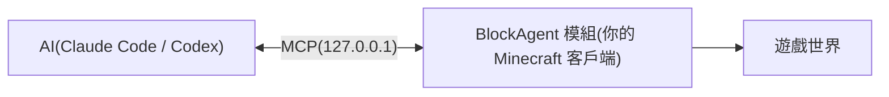

# BlockAgent

讓 AI(Claude Code 或 Codex)以一般玩家的身分玩 Minecraft Java 26.3。需求見 [docs/REQUIREMENTS.md](docs/REQUIREMENTS.md)，技術規格見 [docs/SPEC.md](docs/SPEC.md)。



AI 啟動時會帶上「怎麼玩」的提示詞 [prompts/how-to-play.md](prompts/how-to-play.md)(方向見需求 6.2 節)。啟動後自動送出的開場白在 [prompts/kickoff.md](prompts/kickoff.md)。

## 需要的東西

- Minecraft Java 26.3、Java 25
- Fabric Loader 0.20.1 以上、Fabric API `0.166.2+26.3`
- Baritone `baritone-unoptimized-fabric-1.20.0.jar`([官方 release](https://github.com/cabaletta/baritone/releases/tag/v1.20.0)；要用 unoptimized 版)
- Claude Code 2.1.329 或 codex-cli 0.171.0(其他版本啟動時會警告)

## 建置與安裝

```bash
./gradlew build
```

把 `build/libs/blockagent-<版本>.jar`(版本號是建置時的日期加時間，例如 `blockagent-2026.11.22-1853.jar`)、Fabric API、Baritone 三個 jar 放進 `.minecraft/mods/`。

## 使用

1. 開 Minecraft、進入世界。左上角會顯示「○ 待命 按 ` 開始」。
2. 在終端機啟動 AI 端(互動視窗，你可以直接看輸出、跟它說話)。啟動後會自動送出一句開場白讓 AI 開始，想指定目標就直接在視窗裡跟它說：

```bash
bin/blockagent-claude
```

```bash
bin/blockagent-codex --login
```

```bash
bin/blockagent-codex
```

(Codex 第一次用要先 `--login`，它用的是專用的設定目錄 `~/.blockagent/codex-home`，不碰你的 `~/.codex`。)

腳本會自己找執行中的遊戲：正式版的連線資訊在 `~/.blockagent/runtime.json`，開發版(`./gradlew runClient`)的在專案的 `build/blockagent-home/runtime.json`。接上開發版時會印出「(接上開發版遊戲：…)」。

要指定 Claude 的模型，加上環境變數，例如 `BLOCKAGENT_CLAUDE_MODEL=haiku bin/blockagent-claude`(Codex 用 `BLOCKAGENT_CODEX_MODEL`)。

Codex 預設用 `gpt-6.1-terra` 遊玩，定計畫或接到大目標時找 `gpt-6.2-sol` 幫忙規劃(`request_plan`)。規劃在背景跑，AI 不用停下來等；模組會自動附上 AI 的狀態、背包、記憶和最近的失敗，結果送回遊戲後成為「目前計畫」，每個任務結束時提醒 AI 下一步(docs/SPEC.md S5.6、S11.7)。規劃需要 Python 3.11 以上，沿用 BlockAgent 專用的 Codex 登入。要換規劃模型用 `BLOCKAGENT_PLANNER_MODEL`，設成空的就不開規劃、只用一個模型玩：

```bash
BLOCKAGENT_PLANNER_MODEL= bin/blockagent-codex
```

規劃呼叫的耗時、結果與 token 用量記在專用 Codex 目錄的 `blockagent-planner-usage.jsonl`。

3. 在遊戲裡按 `` ` `` 讓 AI 開始；再按一次立刻暫停。`\` 收起或展開左上角的 AI 面板。按鍵可以在控制設定裡改。

AI 面板依序顯示目前動作、目標和 AI 回報的想法摘要。長期和短期目標同列，以「/」分隔。

交給 AI 時會自動放開游標，可以直接移到另一個視窗。想看看周圍時在遊戲畫面點一下抓回游標(這一下不算攻擊，AI 也不會停)，轉視角時鏡頭交給你，停 3 秒後再跟著 AI 走；按左 Alt 放開或抓回游標。暫停或接手時恢復滑鼠轉視角。預設按下移動、跳躍、蹲下、攻擊或使用鍵時會接手。

生存和創造模式都能玩。創造模式下 AI 會從創造物品欄拿東西(`creative_take`)，不會飛；你讓它飛著的時候，它一開始移動就會先落地。

AI 端只能用模組的工具：碰不到你電腦上的其他檔案和程式，也不能上網(docs/SPEC.md S11)。

設定檔在 `.minecraft/config/blockagent.json`(時間上限、發言間隔、要鎖定開啟的反射等)。AI 改不了它。時間上限 `sessionMinutes` 預設 0=不限時，填分鐘數才會時間到自動停。
每個世界的記憶、目前計畫、所有權帳本和紀錄在 `.minecraft/blockagent/`。

## 測試(都不呼叫 AI)

```bash
./gradlew test
```

```bash
./gradlew cliTest
```

```bash
./gradlew runClientGameTest
```

- `test`：單元測試(MCP 伺服器、規則、帳本、配方、彈道)。
- `cliTest`：T8、T9。用本機的假模型伺服器啟動 Claude Code 和 Codex，確認它們只看得到模組的工具、越權的呼叫全部失敗。需要本機裝有兩個 CLI。
- `runClientGameTest`：核心安全底線與 Mixin 整合測試(`SmokeGameTest`、`ChatGameTest`、`RulesGameTest`、`SessionGameTest`、`ServerAndCreativeGameTest`)。會開一個 Minecraft 視窗自動跑完，可加 `-PtestOnly=ChatGameTest,RulesGameTest` 只跑幾個。
  `ServerAndCreativeGameTest` 會啟動專用伺服器驗證創造模式移動、`/fill` 權限與斷線收尾；執行時需加上 `-Peula=true` 表示同意 Minecraft EULA(`./gradlew runClientGameTest -Peula=true`)。

### 規劃服務測試

規劃服務的測試跟著 `./gradlew test` 一起跑(`pythonTest`)。規劃服務要 Python 3.11 以上(用到 `tomllib`)，`bin/python311` 會依序找 `python3.15`…`python3.11`、`python3`，也可以用 `BLOCKAGENT_PYTHON` 指定執行檔；macOS 內建的 `/usr/bin/python3`(3.9)不能用。
