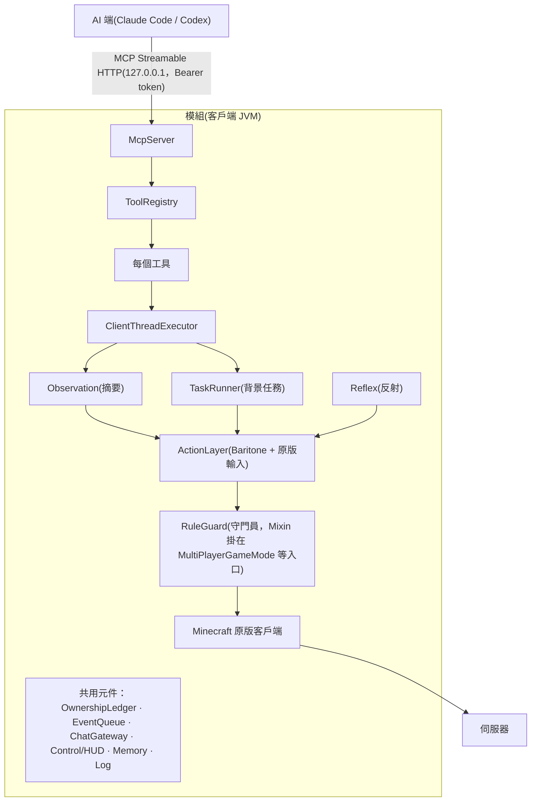

# Minecraft AI 自主代理 — 技術規格(模組 + 啟動與權限)

> 2026-11-19
> 依據：`docs/REQUIREMENTS.md`(2026-11-19 版)
> 範圍：需求第 5 節(模組)與第 6.1 節(啟動與權限)。**6.2 節提示詞的內容不在本文件範圍**(內容在 `prompts/how-to-play.md`)，本文件只定義怎麼帶入(S11.3、S11.4)。
> 狀態：草稿，待審閱。審閱通過前不開始寫程式。

---

## 0. 文件說明

### 0.1 編號規則

- 每條規格編號為 `S<節>.<序號>`，例如 `S7.3`。
- 每條規格後面用方括號標出對應的需求，例如 `[M5.2]`、`[A1.2]`。一條規格可以對應多個需求。
- 驗收測試編號 `T<9.1 條號>`，例如 `T1` 對應 9.1 第 1 條。
- 附錄 A 是「需求 → 規格 → 測試」的完整對照表，驗收時用它查。

### 0.2 用詞

| 用詞 | 意思 |
|---|---|
| 模組 | 裝在使用者 Minecraft 客戶端的 Fabric mod(本專案的主體) |
| AI 端 | Claude Code 或 Codex 的互動視窗 |
| 工具 | 模組透過 MCP 提供給 AI 的 tool |
| 任務 | 需要多個 tick 才能完成、在背景執行的動作(S4.3) |
| 守門員(RuleGuard) | 執行第 5.5 節規矩的唯一元件(S7) |
| 工作階段(session) | 從使用者按鍵讓 AI 開始玩，到時間到、離開世界或斷線為止(S8.1) |
| 自己的 | 依 S7.4 所有權帳本判定屬於 AI 這個玩家的方塊、容器或物品 |

---

## 1. 平台與相依(已查證)

### 1.1 版本支援的查證結果

下列結果都查過官方來源或本機實際檔案，不是推測。

| 項目 | 結果 | 查證方式 |
|---|---|---|
| Minecraft Java 26.3 | 2026-09-15 正式發布，最低需求 Java 25 | Minecraft Wiki；本機已有 openjdk 25.0.5 |
| Fabric Loader | 支援 26.3，最新穩定版 **0.20.1** | `meta.fabricmc.net/v2/versions/loader/26.3`(標記 stable) |
| Fabric API | 最新 **0.166.2+26.3** | `maven.fabricmc.net` 的 maven-metadata.xml |
| 混淆 | 26.x 不再混淆，沒有 Yarn mappings，直接用 Mojang 原名 | `meta.fabricmc.net/v2/versions/yarn/26.3` 回傳空陣列；Fabric 官方 26.1 移植文件 |
| Baritone | 官方 cabaletta/baritone **v1.20.0(2026-09-23)**，release 說明寫 "For Minecraft 26.3. … Fabric is supported."；附有 `baritone-api-fabric-1.20.0.jar`、`baritone-standalone-fabric-1.20.0.jar` | GitHub Releases API；該 tag 的 `gradle.properties` 寫 `minecraft_version=26.3`、`java_version=25` |
| Baritone 授權 | LGPL-3.0 | 該 tag 的 `LICENSE` |

本文件引用的 Minecraft 類別與方法名稱，都已用 `javap` 對本機 Gradle 快取裡的 `minecraft-merged-deobf-26.3.jar` 確認存在。

### 1.2 相依與建置

- **S1.1** 目標版本鎖定為 Minecraft 26.3、Java 25、Fabric Loader ≥ 0.20.1、Fabric API 0.166.2+26.3。`fabric.mod.json` 宣告 `"minecraft": "26.3"`，不宣告範圍版本。(第 5 節所有需求的前提；對應需求 3.1 的遊戲版本)
- **S1.2** Gradle plugin 用 `net.fabricmc.fabric-loom`(不 remap 的版本)。Loom 和 Gradle 的版本以 fabricmc.net/develop 對 26.3 的建議為準。程式碼一律用 Mojang 原名。
- **S1.3** Baritone 以**獨立 jar** 的方式和本模組一起放進 `mods/`，不打包進本模組的 jar。用 `baritone-unoptimized-fabric-1.20.0.jar`：S1.5 的 Mixin 要掛在 Baritone 內部類別上，unoptimized 版保留原本的類別名稱(已確認裡面有 `baritone/pathing/movement/CalculationContext.class`)。本模組只用 `compileOnly` 依賴 `baritone-api-fabric-1.20.0.jar`。兩個 jar 的 SHA-1 已和官方 release 的 `checksums.txt` 比對一致。`fabric.mod.json` 的 `depends` 列出 `baritone`。
- **S1.4** 模組啟動時強制設定以下 Baritone 選項，並在工作階段期間每 20 tick 檢查一次，有被改動就改回去：[M2.4, M2.5, M4.3, M5.4]

  | 設定 | 值 | 原因 |
  |---|---|---|
  | `chatControl`, `chatControlAnyway`, `prefixControl` | `false` | 不讓任何聊天文字(包括 AI 發言、朋友發言)變成 Baritone 指令 |
  | `allowInventory` | `false` | 背包整理由本模組控制，避免 Baritone 繞過守門員搬物品 |
  | `buildIgnoreExisting` | `true` | 建造時不去拆已經存在的方塊 |
  | `breakCorrectBlockPenaltyMultiplier` | `1000000` | 建造時不挖掉已經蓋好的方塊。預設只是成本乘 10，路線不好走時還是會挖穿剛蓋的牆(T13(b) 實測發現) |
  | `allowParkour`, `allowParkourPlace` | `false` | 降低意外掉落或跳進危險地方的機率 |
  | `freeLook` | 平常 `false`；使用者 3 秒內用滑鼠轉過視角時 `true` | 平常鏡頭跟著 AI 的前進方向；使用者在看別的地方時，Baritone 只改移動方向、不轉鏡頭(S8.2a)。這個值每個 tick 由 `Control` 同步，不在 20 tick 的檢查裡 |
  | `chatDebug`, `desktopNotifications` | `false` | 不在聊天框或系統通知顯示除錯訊息 |
  | `useSwordToMine` | `false` | 不拿劍挖方塊，白白耗損耐久 |
  | `allowBreak`, `allowPlace` | 平常 `true`；清空區域(S4.8c)、建造時拆鷹架的期間 `false` | 由目前任務決定(`Task.adjustBaritone`)，20 tick 的檢查重設時也照任務的需要，不會在拆鷹架途中被改回 `true`；任務被反射暫停時照平常的設定 |

  - 啟動時確認 Baritone 的內部類別存在(`CalculationContext`、`BuilderProcess`、`ToolSet`)。找不到表示裝的是混淆版(`baritone-standalone-fabric`)，S1.5 的 Mixin 會靜默失效：記錄錯誤，並在進入世界時於聊天欄(只顯示在自己的畫面)用紅字提醒改裝 unoptimized 版(docs/REVIEW.md H10)。
  - 任務改了的 Baritone 設定(`exploreForBlocks`、`buildInLayers`、`layerOrder`、`maxFallHeightNoWater`、`allowBreak`、`allowPlace`)在任務結束時用 `try/finally` 還原，被反射暫停後恢復時重新套用。

  另外，`build_*` 任務執行期間設 `buildInLayers=true`、`layerOrder=false`(一層一層由下往上蓋)，結束時改回來。不這樣做的話，屋頂可能比角落的柱子先蓋好，剩下的格子就放不進去了(2026-11-20 讓 Haiku 實際蓋房子時發現，T13(b) 重現)。

  創造模式拆鷹架(S4.5a)的期間設 `allowPlace=false`、`allowBreak=false`、`maxFallHeightNoWater=64`，拆完改回來。不關 `allowBreak` 的話，走去拆鷹架的路上會挖穿剛蓋好的牆；不放寬往下跳的高度，站在牆頂就下不去(T14(c) 實測發現)。

- **S1.5** Baritone 的路徑規劃另外掛兩個 Mixin，把守門員的判斷提早到規劃階段，讓路線一開始就避開別人的東西：`baritone.pathing.movement.CalculationContext#breakCostMultiplierAt` 和 `#costOfPlacingAt`。建造時 Baritone 用的是子類別 `BuilderProcess$BuilderCalculationContext`，它覆寫了 `breakCostMultiplierAt`、不會呼叫父類別，所以同一個 Mixin 也要掛在它上面。守門員判定不可破壞或不可放置時回傳 `ActionCosts.COST_INF`。這只是「先避開」，真正擋下動作的是 S7.2 的最後防線。[M5.2, M5.4, M7.6]
- **S1.6** 本模組不使用任何需要伺服器端安裝的東西：不送自訂封包，也不需要朋友那邊裝東西。[限制條件 7]

---

## 2. 整體架構

### 2.1 元件



| 元件 | 職責 |
|---|---|
| McpServer | MCP 協定、驗證、工具分派(S11.2) |
| ToolRegistry | 所有工具的名稱、JSON Schema、處理函式。**和 Minecraft 無關**，可以在 JUnit 裡用假的遊戲後端啟動(T8、T9 要用) |
| ClientThreadExecutor | 把工具呼叫交給 Minecraft client thread 執行，等待結果，逾時 5 秒 |
| Observation | 產生給 AI 的摘要(S3) |
| TaskRunner | 背景任務的生命週期(S4.3) |
| ActionLayer | 把命令轉成 Baritone process 或原版輸入 |
| RuleGuard | 規矩的唯一判斷點與最後防線(S7) |
| OwnershipLedger | 記錄哪些方塊、容器、物品是自己的(S7.4) |
| Reflex | 反射(S9) |
| EventQueue | 通知 AI 的事件佇列與合併(S5) |
| ChatGateway | 收聊天(S3.5)、發言(S6) |
| Control/HUD | 暫停鍵、畫面狀態、工作階段(S8) |
| Memory | 依世界分開的記憶(S4.6) |
| ActionLog | JSONL 紀錄(S9.5) |

### 2.2 執行緒模型

- **S2.1** 所有讀寫遊戲狀態的程式都在 Minecraft client thread 上執行。MCP 的 HTTP 執行緒只負責解析、驗證、排隊，然後等待 client thread 的結果。[M6.1 的反應時間前提]
- **S2.2** TaskRunner、Reflex、守門員在 `ClientTickEvents.END_CLIENT_TICK` 推進。每個 tick 的處理順序固定：Control(暫停、接手、工作階段)→ Reflex → TaskRunner → EventQueue 合併。暫停時 Control 之後的步驟全部略過。[M6.1, M7.10]

### 2.3 兩個 AI 使用同一組工具

- **S2.3** 模組只有一個 MCP 端點和一組工具。Claude Code 和 Codex 看到的工具名稱、說明、參數 schema 都由同一個 ToolRegistry 產生，模組不判斷連進來的是哪一個 AI。[A1.1]
- **S2.3a** 工具說明和參數 schema 是精簡英文(S3.0)。數值範圍、預設值和固定選項寫成標準 JSON Schema 的 `minimum`、`maximum`、`default`、`enum`，讓模型產生參數時就避開越界；名稱已經說明一切的參數不寫 `description`。各背景任務共用的 `replace`、`wait_sec` 只在 `instructions` 說明一次。每個工具帶 MCP Tool Annotations：觀察工具 `readOnlyHint=true`；動作工具另外標 `destructiveHint`(可能挖掉、拆掉、打死或丟掉東西，例如 `break_block`、`mine`、`clear_area`、`build_house`、`build_blueprint`、`attack`、`hunt`、`drop`、`use_item`)和 `idempotentHint`(重複呼叫結果一樣，例如 `equip`、`set_status`、`set_reflex`、`stop`)；`openWorldHint` 只有 `say`(對真人說話)是 `true`。
- **S2.3b** `initialize` 的 `instructions` 說明回應格式(S3.0)、共用參數，以及並發規則：觀察工具可以平行呼叫；背景任務一次只有一個，動作工具不要平行呼叫，否則後到的會得到 `BUSY`。

---

## 3. 交給 AI 的資訊 [M1.1–M1.7]

### 3.0 MCP 文字協定(Compact KV，LLM-first)

使用者決定(2026-11-23，`docs/REVIEW.md`「建議處理方案與落地路線」)：**人類介面維持繁體中文**(HUD、遊戲內 `[AI]` 發言、CLI 提示、朋友聊天原文)，**只給模型讀的 MCP 通訊層改成精簡英文**：`initialize` 的 `instructions`、`tools/list` 的說明與 schema、`tools/call` 的回應、錯誤和事件。英文跟 Minecraft 的 id 對齊，模型不用在中英之間轉換，同樣的資訊也比較短。不做 tokenizer 量測，方向對就好；可以用 `tools-snapshot.json` 的位元組數前後對照當參考。

- **S3.0a 行與鍵值**：回應是幾行純文字。一行由空白分隔的 `key=value` 組成，鍵名用小寫 `snake_case` 英文。值裡有空白、`"`、`|`、`=` 或是空字串時，用 JSON 字串的寫法加雙引號(`"..."`，裡面的 `"`、`\`、換行跳脫)；其他值不加引號，中文也一樣。玩家寫的文字(聊天、玩家名稱以外的告示牌內容、記憶的值、HUD 文字)一律加引號，保持原文。
- **S3.0b 固定寫法**：
  | 東西 | 寫法 | 例子 |
  |---|---|---|
  | 座標 | `x,y,z`，整數、沒有空白，可以直接貼回 `from`/`to` 參數 | `pos=10,64,-3` |
  | 區域 | `from=` 和 `to=`，包含兩端 | `from=0,64,0 to=8,64,8` |
  | 方塊、物品、生物 id | 省略 `minecraft:`，其他命名空間保留 | `oak_log`、`create:wrench` |
  | 方塊狀態 | 原版寫法 | `oak_stairs[facing=north]` |
  | 數量清單 | `id:數量`，逗號分隔；沒有東西寫 `none` | `inv=oak_log:12,cobblestone:30` |
  | 一件物品 | `id`，數量大於 1 加 `:數量`，有耐久、附魔、藥水等再加 `[k=v;k=v]`，多個值用 `+` 串 | `iron_pickaxe[dur=200/250;ench=efficiency:3+unbreaking:2]` |
  | 比值 | `目前/上限` | `hp=18/20` |
  | 方向 | 八方位 `N NE E SE S SW W NW`，距離 1 格內寫 `here`；`dist=` 是四捨五入的直線格數；高低差超過 2 格才加 `dy=+N`/`dy=-N` | `dir=NE dist=12 dy=+5` |
  | 所有權 | 固定三個值：`own`(自己放的)、`other`(別人的人造方塊，含自然生成的建築)、`nat`(天然) | `owner=nat` |
  | 布林 | `true`/`false` | `flying=true` |
- **S3.0c 動作結果**：成功的第一行以 `OK` 開頭，後面接動詞和鍵值，例如 `OK equipped item=shield slot=offhand`。背景任務開始時是 `OK started task=<name> ...`(後面接事前檢查的鍵值，S4.4)；一開始就結束時是 `OK done task=<name> ... hp=20/20 food=18/20 pos=10,64,-3 time=day`(S4.3)。觀察工具不加 `OK`，直接回傳內容。
- **S3.0d 錯誤**：一律一行：
  ```
  ERR <CODE> <key=value ...> | <short reason> | hint=<next action>
  ```
  `CODE` 是 S3.6 的錯誤碼；鍵值放可以直接拿來用的資料(例如 `missing=cobblestone:3`、`pos=10,64,-3`)，沒有就省略；`reason` 是一句短英文；`hint` 寫下一步可以怎麼做，沒有可說的就省略整段。同一個錯誤碼常用的下一步(例如 `BUSY` 的「`stop`，或加 `replace=true`」)由 `ErrorCode` 統一提供，工具有更具體的建議時覆蓋它。模組內部也用同一組 `code`、`reason`、`hint`(`ToolResult`)，測試斷言看錯誤碼和固定鍵，不看句子。
- **S3.0e 事件**：工具回應後面附上的事件、`wait_events` 等到的事件，都在 `[EVENTS]` 這一行之後，一則一行：
  ```
  [EVENTS]
  [URGENT] user_paused: all actions stopped | hint=call wait_events until user_resumed
  [PROMPT] task_done: task=mine mined=8/8 hp=20/20 food=17/20 pos=12,40,-7 time=day dusk_in=90s
  [BATCH] chat(2): Ming="好餓"; Amy="哈哈"
  [WARN] events_dropped: n=3
  ```
  每行帶出等級(`URGENT`、`PROMPT`、`BATCH`，S5.2)和事件型別(`Event.type()`)，AI 依型別分支。合併類(`BATCH`)同組有好幾則時寫成 `<組名>(<則數>): 內容; 內容`，只有一則時就是 `<組名>: 內容`。佇列滿了丟掉舊事件時多一行 `[WARN] events_dropped: n=<則數>`。
- **S3.0f** 以上格式由 `blockagent.mcp.Kv`(鍵值與引號)、`ToolResult`(`OK`/`ERR`)和 `EventQueue.render`(事件)產生，各工具不自己拼格式。

### 3.1 共同格式

- **S3.1** 觀察工具回傳精簡文字(S3.0)，不回傳原始 NBT、區塊資料或完整實體清單。一般摘要的預設上限為 1,500 字元，超過時最後一行寫 `truncated=true | hint=...`。`inspect_area` 的逐格回應以起始索引 `offset` 分頁，每頁最多 32 格。[M1.7]
- **S3.2** 座標、方向、所有權照 S3.0b。時間寫成 `time=day|dusk|night|dawn`，切點對齊原版：`day` 是 0–11999 和 23460–23999(23460 起晴天不死系會自燃)、`dusk` 是 12000–13187(晴天 12542 起能睡)、`night` 是 13188–22799(地表開始生怪)、`dawn` 是 22800–23459。後面接到下一個切點的倒數：白天 `dusk_in`、黃昏 `night_in`、晚上和黎明 `day_in`，2 分鐘以上四捨五入到分鐘(`5min`)，以下寫秒數(`50s`)。最後是 `weather=clear|rain|thunder`。[M1.7]
- **S3.3** 一般工具的回應最後都附上「未讀事件摘要」(S5.4，`[EVENTS]` 區塊，S3.0e)，讓 AI 不用另外查詢。[M3.1]

### 3.2 觀察工具

| 工具 | 內容 | 需求 |
|---|---|---|
| `get_self` | 位置、所在維度、生態域、面朝方向(`face=`，八方位)；遊戲模式(創造模式另外提醒「挖掉的方塊不會掉落，要材料用 creative_take」，飛行中也會標出)；血量、飢餓度、飽和度、氧氣；經驗等級；狀態效果(`effects=poison:1:12s,...`，等級和剩餘秒數)；手上和副手物品、盔甲(耐久、附魔、藥水內容、書名、自訂名稱，S3.0b 的物品寫法)；背包(同種物品合併計數，標出可吃、可當燃料的物品；附魔書、藥水這類同 id 也不同的物品另外列在 `special=`)；目前任務與暫停狀態；啟用中的反射 | M1.1 |
| `get_surroundings(radius=16, detail=false)` | 腳下方塊與光線；地形概要(地表、洞穴、水邊、高度落差)、面朝方向與周圍已載入生態域方向；**重要方塊**依種類分組，列出最近的位置和數量(礦石、原木、水、岩漿、工作台、熔爐、箱子、床、門)，每組標出所有權(`own`/`other`/`nat`)；危險(岩漿、懸崖、火)；生物依 `hostile`、`neutral`、`protected`、`passive` 分組，每種列出數量與最近個體的 id 和方向(`detail=true` 展開多隻)；**載具**(船、礦車：id、位置、誰在上面，`mount` 用)；**地上的掉落物**(依物品 id 合併計數，列最近那一堆的位置)；時間、天氣 | M1.2 |
| `inspect_area(from, to, mode=auto, type?, offset=0, limit=32)` | 讀取目前維度的長方體(含兩端，最多 32,768 格)。小範圍或指定方塊時預設列出座標、狀態與所有權，其他範圍預設統計方塊種類。分開標示空氣、未載入及超出世界範圍。 | M1.2, M1.7 |
| `find_blocks(type, radius=48, max=10)` | 在已載入的區塊中找指定方塊，回傳最近的 N 個位置與所有權標記。`type` 可用逗號列出最多 8 種，各自回報，全部找不到才回傳 `NOT_FOUND` | M1.2 |
| `get_players` | 附近其他玩家：名稱、座標(`pos=`，可以直接拿去 `goto`)、距離方向、手上物品、盔甲、最近的行為(S3.4) | M1.3, M1.4 |
| `get_chat(since?)` | 最近的公開聊天(S3.5)，預設最近 20 則 | M1.5 |
| `get_task` | 目前任務的狀態與進度(S4.3) | M2.7, M2.10 |

### 3.3 其他玩家的位置與物品

- **S3.7** 其他玩家的資料來自客戶端已知的 `AbstractClientPlayer` 實體(伺服器同步範圍內)。超出同步範圍就不列，而是寫 `players=none note="players outside tracking range are not visible"`，不猜測位置。[M1.3]

### 3.4 其他玩家大概在做什麼(推斷)

- **S3.4** 用客戶端看得到的訊號推斷，並標明「推斷」：[M1.4]

  | 行為 | 訊號 |
  |---|---|
  | 挖東西 | `ClientboundBlockDestructionPacket`(帶有挖的人的 entity id 和方塊位置)；推斷時加上被挖方塊的種類，例如「在挖礦(iron_ore)」 |
  | 蓋東西 | 該玩家 4 格內有方塊被放置，而且他的手正在揮動、手上拿著方塊 |
  | 打怪 | 揮手動作，而且 4 格內有生物出現受傷動畫 |
  | 受傷 | 該玩家出現受傷動畫(`hurtTime > 0`) |
  | 其他 | 正在移動、站著不動、拿著某物品 |

  推斷結果寫成固定詞(`activity=mining:iron_ore,building,fighting:zombie,hurt,moving,idle`)，只保留最近 30 秒。這只是資訊，模組不會根據推斷結果做任何動作(S4.7)。

### 3.5 遊戲聊天

- **S3.5** 用 Fabric API 的 `ClientReceiveMessageEvents`(CHAT 和 GAME)收聊天。轉交規則：[M1.5]
  1. 玩家聊天(`ClientboundPlayerChatPacket` 或 disguised chat)：聊天類型是 `ChatType.CHAT`、`SAY_COMMAND`、`EMOTE_COMMAND` 的，**原文**交給 AI，附上發言者名稱與時間。
  2. 其他聊天類型一律**丟棄**(白名單，docs/REVIEW.md M11)：`MSG_COMMAND_INCOMING`、`MSG_COMMAND_OUTGOING`、`TEAM_MSG_COMMAND_INCOMING`、`TEAM_MSG_COMMAND_OUTGOING` 是私訊，伺服器自訂的類型和沒有類型的也不轉交，不進任何 AI 看得到的地方(包括 `get_chat`、事件、紀錄裡的 AI 可讀欄位)。
  3. 系統訊息(`ClientboundSystemChatPacket`)：先比對「私訊樣式」清單，符合的丟棄。預設清單包含原版 `commands.message.display.incoming` 的翻譯樣式，以及常見伺服器外掛的私訊格式(例如 `[某人 -> 我]`、`某人 whispers to you`)。清單放在設定檔，可以增加；寫錯的 regex 略過並在日誌警告，不影響模組啟動。比對時整段訊息都算(多行的私訊也比得到)。不符合的系統訊息(死亡訊息、進度、加入/離開)以 `system="原文"` 轉交。
  4. 自己(AI 或使用者用同一帳號)送出的訊息標記為 `me`，不當成朋友的發言；AI 的發言以伺服器轉回來的那一則為準，只記一次。系統訊息標記為 `system`。聊天事件和 `get_chat` 都寫成 `名稱="原文"`。
- **S3.5a** 聊天內容不經過任何關鍵字比對而觸發動作(S4.7)。模組只負責轉交原文。[M2.5]

### 3.6 動作失敗的原因

- **S3.6** 所有工具失敗時回傳 S3.0d 的一行 `ERR`，例如：[M1.6]

  ```
  ERR MISSING_MATERIALS missing=cobblestone:3 | not enough materials | hint=mine or craft the missing items first
  ```

  `reason` 是一句短英文，說明原因；能換方法時寫在 `hint`。錯誤碼清單：

  | code | 意思 | 範例 |
  |---|---|---|
  | `MISSING_MATERIALS` | 材料不夠 | `missing=oak_planks:3` |
  | `MISSING_TOOL` | 沒有合適的工具 | `ERR MISSING_TOOL block=iron_ore need=stone_pickaxe+ \| no suitable tool in inventory` |
  | `NO_STATION` | 需要工作站，但附近沒有，也做不出來 | `no furnace within 32 blocks and none in inventory \| hint=craft furnace` |
  | `NOT_FOUND` | 已載入範圍內找不到 | `block=iron_ore radius=48 \| none found in loaded chunks \| hint=search=true` |
  | `PATH_BLOCKED` | 到不了 | `pos=10,64,-3 \| out of reach \| hint=goto closer first` |
  | `RULE_PROTECTED_BLOCK` | 規矩：別人的方塊 | `block=oak_planks pos=10,64,-3 owner=other \| placed by someone else` |
  | `RULE_PROTECTED_ENTITY` | 規矩：受保護的生物 | `target=Ming \| players, pets and villagers are protected` |
  | `BUSY` | 已經有任務在跑 | `task=mine \| a task is running \| hint=stop, or pass replace=true` |
  | `PAUSED` | 使用者暫停中 | `\| paused by user \| hint=wait_events until user_resumed` |
  | `SESSION_ENDED` | 工作階段已結束 | `\| session ended` |
  | `CHAT_BLOCKED` | 發言被擋 | `\| messages must not start with /` |
  | `RATE_LIMITED` | 發言太頻繁 | `wait_sec=11 \| too soon after the last message` |
  | `CHAT_DISABLED` | 發言功能已關閉 | `\| chat disabled by user` |
  | `INVALID_ARGUMENT` | 參數錯誤 | `item=iron_pick \| unknown item id` |
  | `INTERRUPTED` | 被反射或使用者打斷 | `reflex=retreat \| interrupted by reflex` |
  | `TIMEOUT` | 任務超過時間上限 | `task=mine limit_min=10 \| task timed out` |
  | `WRONG_GAME_MODE` | 目前的遊戲模式不能用這個動作 | `mode=survival \| creative mode only` |
  | `INTERNAL` | 模組內部錯誤(不是 AI 的問題) | `\| internal error: NullPointerException` |

---

## 4. AI 能用的動作 [M2.1–M2.10]

### 4.1 M2.8 的層級(使用者已選定：B「單一目標」)

- **S4.1** 高階命令的層級定為**單一目標**：一個命令完成一件明確的事，包括找路和必要的工作站，但**不自動收集缺少的材料**。缺材料時在開始前回報缺什麼(S4.4)，由 AI 自己決定先去收集什麼。[M2.8, M2.9]
  - 自動做的事：找路、找到目標方塊、挖、撿起自己挖出來的東西、換上合適的工具、**用背包裡現有的材料**做出並放下需要的工作台或熔爐。
  - 不自動做的事：去採集缺少的材料、展開配方樹、連續做多個命令。

### 4.2 工具清單

**基本動作**(同步完成，或者是很短的任務)：

| 工具 | 說明 | 需求 |
|---|---|---|
| `goto(x,y?,z, range=1)` | 走到某處(背景任務)；省略 `y` 時只比對水平位置、沿地表走 | M2.1, M2.7 |
| `goto_block(type, radius=48)` | 走到最近的某種方塊旁(背景任務) | M2.1, M2.7 |
| `look_at(x,y,z)` | 轉頭 | M2.1 |
| `break_block(x,y,z)` | 挖一格。一般操作需在觸及範圍內(S4.6f) | M2.1 |
| `place_block(x,y,z, item, facing?)` | 放一格，等伺服器確認再回傳。一般操作需在觸及範圍內、有支撐面和背包材料(S4.6f)；被規矩擋下時回報那個錯誤碼和原因。不帶 `facing` 的生存模式放置雖然不是背景任務，也照樣尊重進行中的任務(`replace=false` 回 `BUSY`，`replace=true` 先取消舊任務)。`facing` 見 S4.2b | M2.2 |
| `use_block(x,y,z)` | 對方塊按右鍵：開門、按鈕、拉桿、開容器。被規矩擋下時照實回報那個錯誤碼和原因，不包成「沒有反應」 | M2.2, M5.3 |
| `equip(item, slot="mainhand")` | 換手上或身上的裝備 | M2.1 |
| `eat(item?)` | 吃東西(不指定就挑最好的) | M2.1 |
| `attack(target)` | 攻擊某個生物一下(entity id 或種類+最近)。`attack`、`hunt`、`use_on_entity`、`mount` 的 `target` 都接受字串或整數 id；給 id 時也要在該工具的範圍內、是該工具能選的實體，否則 `NOT_FOUND` | M2.1 |
| `use_item(item, x?,y?,z?)` | 使用手上的物品：給座標就對那格用(水桶倒水或撈水、打火石、骨粉)，沒反應時改成直接使用。倒水、點火的位置比照放方塊，撈水比照破壞，點燃或催熟別人的方塊比照用工具改變方塊(S7.3) | M2.2 |
| `dismount()` | 從載具下來：按住蹲下鍵(很短的任務) | M2.1 |
| `drop(item, count, toward?)` | 丟出物品，可以指定朝向某個位置 | M2.2 |
| `creative_take(item, count=1)` | **只在創造模式**：從創造物品欄拿東西放進背包(S4.6c) | M2.4 |
| `stop()` | 停止目前的任務 | M2.7 |
| `set_status(text, thought?, short_goal?, long_goal?)` | 更新 HUD。動作最多 24 字，想法最多 32 字，兩個目標各最多 48 字。略過的選填欄位沿用原值，空字串清除；動作在任務結束時自動清除(S8.3) | M6.3 |

**高階命令**(背景任務，開始前先做 S4.4 的檢查)：

| 工具 | 一件事 | 開始前檢查 | 需求 |
|---|---|---|---|
| `mine(block, count, radius=48)` | 找到指定方塊，走過去、挖、撿起來，直到數量達到。`block` 可以是方塊 id 或群組(`log`、`stone`、`coal_ore`、`iron_ore`…)| 有沒有挖得動的工具；背包空間；已載入範圍內有沒有足夠的目標(沒有就 `NOT_FOUND`，加 `search=true` 才會往外找，最多 5 分鐘) | M2.1, M2.8, M2.9 |
| `hunt(target)` | 追蹤指定 entity id 或生物種類(48 格內最近)的生物並打倒，擊殺後走近並撿取掉落物。敵對生物照 S9.1b 的戰術打(苦力怕打了就退、遠程怪舉盾衝過去、有弓就射)，其他生物走近用劍或斧頭打 | 目標消失、攻擊被守衛擋下，或擊殺後未能撿取時回報原因 |
| `craft(item, count=1)` | 合成。需要工作台時，附近 16 格有就走過去用(別人的也可以，M5.3)；沒有就用背包材料做一個放下。每一批最多做到材料的堆疊上限那麼多次(弓 1、雪球 16)；放進合成格的數量、拿出來的數量都照格子實際的變化算，背包滿了拿不出來就照實回報 | 用配方資料計算所需材料(包括做工作台的木板)；不夠就回報缺什麼 | M2.1, M2.8, M2.9 |
| `smelt(item, count, fuel?)` | 熔煉。找附近 32 格的熔爐(別人的也可以)；沒有就用背包材料做一個放下；放入原料和燃料，等燒好，拿出產物。燃料比燃料格一次放得下的多時(木棒超過 64 根、木鏟一次只能放 1 個)，燒完再補；熄火、產物格空了，而且燃料格空了(燒完)或原料格空了(被拿走)就停下回報。給產物時，背包裡有好幾種原料就優先用數量夠的那種；指定的 `fuel` 不是燃料就回傳 `INVALID_ARGUMENT` | 原料、燃料是否夠；熔爐是否可用 | M2.2, M2.8, M2.9, M5.3 |
| `build_wall(from, to, height, material, dry_run=false)` | 在兩點之間蓋一面牆(直線，指定高度，最多 32,768 格) | 材料數量；位置上有沒有別人的方塊擋著(只填空氣和可替換方塊，不拆東西) | M2.2, M2.8, M2.9 |
| `build_house(from, to, material, height=4, floor?, roof?, door_side=north, door?, window?, name?, id?, dry_run=false)` | 依現場地形算出一間能住的房子(地基、地板、牆、窗、平屋頂、門)，存成藍圖再開工(S4.8b)。給 `id` 時重新量地形、重算同一份藍圖 | 地面高低差；材料數量；S4.8c 的施工規則 | M2.2, M2.3, M2.8, M2.9 |
| `build_blueprint(action, origin?, parts?, add_parts?, name?, id?, dry_run=false, offset?)` | 儲存、施工、查看、修改、拆除多材質藍圖：`create`、`resume`、`list`、`show`、`update`、`demolish`、`delete`(S4.8a、S4.8c) | 比對實際方塊、已載入區塊、空格、衝突及材料，依 S4.8c 決定每格放、挖、拆或略過 | M2.2, M2.3, M2.8, M2.9 |
| `clear_area(from, to, block, replace=false)` | 限在包含兩端的區域(最多 32,768 格)清除指定 ID 或群組的天然方塊；`block` 可用逗號列出最多 8 種 | 鎖定開工時已載入且符合守門員規則的目標。走路時禁挖禁搭，每次以一般玩家操作拆除前重新確認。結果回報實際清除、自然消失、被換掉及無法抵達格數。 | M2.2, M2.3, M5.1 |
| `till_and_plant(from, to, seed)` | 在範圍內把天然泥土或草地鋤成耕地，種下種子(`seed` 是 `wheat_seeds`、`carrot`、`potato`、`beetroot_seeds` 其中之一) | 有鋤頭；種子數量；範圍內有沒有水(沒有就提醒)；範圍跟 `inspect_area` 一樣最多 32,768 格 | M2.2, M2.8 |
| `harvest(from, to, replant=true)` | 收成**自己種的**成熟作物並補種。掃描範圍是 `from`/`to` 的長方體再往下 1 格、往上 2 格(兩端的 y 誰大都可以)，最多 32,768 格 | 範圍內有自己種的作物 | M2.2, M2.8 |
| `sleep(x?,y?,z?)` | 走到床邊睡。可以指定床；不指定就用附近 32 格最近、沒人在睡的(別人的也可以) | 現在能不能睡(晚上或雷雨)；指定的格子是不是 32 格內的床、有沒有人在睡，或附近有沒有空床 | M2.2, M5.3 |
| `follow(player, distance=3, max_sec=60)` | 跟著一位玩家走，保持距離(最多 600 秒)。只在 AI 呼叫時開始，時間到、對方不見、stop、暫停或接手就停 | 附近有沒有這位玩家 | M2.1, M2.5 |
| `use_on_entity(target, item?)` | 走到生物旁邊，拿著物品按右鍵(剪羊毛、餵食繁殖、拴繩、擠奶)，省略 item 就空手；撿起互動後掉在旁邊的東西。村民和流浪商人一律不能互動(不做交易，S7.7、A3) | 背包有這個物品；目標是否受保護(S7.7 的 `interact`) | M2.2, M5.1 |
| `mount(target)` | 走過去坐上船、礦車等載具。不會自己開船；乘坐中不能開始走路的任務，要先 `dismount` | 目標是否受保護(馴服的馬算寵物，不分主人，自己的也擋；村民和流浪商人一律擋下) | M2.1 |
| `fish(count=1, max_sec=120)` | 走到 16 格內的水邊拋竿，浮標被咬住就收竿，釣到 count 次或時間到 | 背包有釣竿；附近有沒有上方是空氣的水源 | M2.1, M2.8 |
| `chest(action, x,y,z, items?)` | 走到箱子、木桶、界伏盒或終界箱前：`list` 看內容，`put` 放東西，`take` 拿東西(別人的和自然生成的也可以)。結果都附上關上前的內容(`contents=id:數量,... free=空格數`，附魔書等另外列在 `special=`) | `put` 時背包有這些東西；目標是不是箱子 | M2.2, M5.3 |

**記憶**(S4.8)：`memory_read()`、`memory_write(key, value)`、`memory_delete(key)`。

**反射開關**(S9.4)：`set_reflex(name, enabled)`、`list_reflexes()`。

**叫醒**(S5)：`wait_events(max_wait_sec=30, task_only=false)`。

**發言**(S6)：`say(text)`。

- **S4.2b** `place_block` 的 `facing`(A6，2026-11-23)：選填 `north`/`south`/`east`/`west`/`up`/`down`，意思是**放好之後**方塊狀態的朝向：有 `facing`(含 `HORIZONTAL_FACING`、漏斗的 `FACING_HOPPER`)就比那個方向；原木這類的 `axis` 比軸(`north`/`south` 都是 `z`)；告示牌、旗幟、頭顱的 `rotation` 比四個正方向。
  - 每種方塊決定朝向的規則不同(樓梯朝玩家視線、熔爐和箱子背對玩家、漏斗和牆上的火把看點的那一面、原木看點的面的軸、觀察者看上下視線)，所以不逐一手寫，而是用原版自己的放置邏輯(`BlockItem.getPlacementState`)模擬「點旁邊哪個實心方塊的哪一面 × 視角(四個水平方向，平視、往下、往上)」，挑出會放成指定朝向的組合。不點有方塊實體的鄰格，也不點右鍵會打開介面或切換狀態的方塊(工作台、門、活板門、柵欄門、床、按鈕、拉桿，跟守門員分辨「放置/使用」用同一個判斷 `RuleGuard.isInteractive`)；不帶 `facing` 時挑支撐面也一樣。萬一點了還是打開介面，立刻關掉並回 `INVALID_ARGUMENT`。
  - 點擊封包不帶視角，伺服器用上一次同步的視角決定朝向，所以先轉向等 3 個 tick 再點(背景任務 `place_block`，照常吃 `wait_sec`)。還沒點下去就被反射(進食、自衛)暫停時，恢復後重新轉向、重選物品並重檢距離。伺服器確認後讀方塊狀態：朝向不對回 `ERR INVALID_ARGUMENT ... | placed with facing=X instead of Y | hint=break_block it, then place again from another side`。
  - 方塊沒有任何朝向屬性時，不管背包和距離，一律先回 `ERR INVALID_ARGUMENT ... | this block has no facing property | hint=omit facing`(火把要貼牆才有朝向，不算)。有朝向但目前的鄰格放不出那個方向時，回 `INVALID_ARGUMENT` 並在 `possible=` 列出放得出的朝向；創造模式用指令放時，方塊不接受這個方向(例如樓梯、漏斗朝上)也一樣回 `possible=`。
  - 創造模式能用指令放時(S4.6f)，直接把朝向寫進方塊狀態再送指令。
- **S4.2a** 工具整併(使用者決定，2026-11-23，`docs/REVIEW.md` A7)：`preview_build` 併入 `build_wall`/`build_house`/`build_blueprint` 的 `dry_run`(唯讀、暫停時也能用，阻擋明細用 `offset` 分頁)；`chest_put`、`chest_take` 併成 `chest(action=list|put|take)`。`memory_*` 和 `list_reflexes`/`set_reflex` 保持獨立：依 `action` 改變必填參數的工具容易讓模型填錯，這兩組又不是重複的 schema。區域工具的兩個端點一律叫 `from`/`to`(`"x,y,z"`)；舊藍圖記下的 `corner1`/`corner2` 照樣讀得懂。
- **S4.2** 工具清單裡**沒有**：自動跟隨、自動幫忙、連線伺服器、切換世界、離開世界、執行指令、Baritone 指令轉送。`follow` 只在 AI 自己呼叫時才跟，不會因為看到朋友就自己開始。[M2.5, M2.6]
- 尋路避開怪物：Baritone `avoidance=true`，8 格內有敵對生物的路線成本較高(Baritone 內建排除沒生氣的終界使者、殭屍化豬布林和亮處的蜘蛛)。
- 挖方塊時(`break_block`、`clear_area`，以及 Baritone 的 `mine` 和尋路途中)不用劍：選工具以徒手為基準，速度一樣時不拿會耗損耐久的東西；Baritone 設定 `useSwordToMine=false`。Baritone 選工具的修正(`ToolSetMixin`，必要時從背包換一格上快捷列)只在 AI 執行中介入，暫停、待命時不動使用者的快捷列。

### 4.3 背景任務

- **S4.3** 高階命令和 `goto` 類的命令是**背景任務**：[M2.7, M2.10]
  - 工具呼叫開始任務後回傳 `OK started task=<name> <事前檢查的鍵值>`(S3.0c)。
  - 背景任務的工具都有可選的 `replace`(預設 `false`)和 `wait_sec`(0 到 120，**預設 30**；使用者決定，2026-11-23，A10：原本預設 0，模型漏帶時白白多一輪 `wait_events`)。大於 0 時，任務開始後依 `wait_events(task_only=true)` 的規則等到任務結束或逾時，把等到的事件接在 `OK started` 後面一起回傳；等不到時多一行 `WAIT task_running task=<name> waited=<秒>s | hint=wait_events task_only=true ...`。`0` 表示開始後立刻回傳。每次模型呼叫都要重送整段脈絡，省下一次 `wait_events` 呼叫就省下一次重送。
  - 任務一開始就結束時(例如創造模式一碰就碎、花草一下就打掉、那格本來就是空的)，工具的回應直接寫出結果(`OK done task=break_block pos=... state=broken hp=... food=... pos=...` 或 `ERR`)，不另外送 `task_done` 事件。
  - 同一時間只有一個任務。已經有任務在跑時，新命令回傳 `BUSY`；加上 `replace=true` 會取消舊任務，並在事件裡說明舊任務做到哪裡。坐在載具上不能開始會走路的任務，這個檢查在取消舊任務之前。
  - 反射(脫困以外)正在接手時不開始新任務，回 `BUSY reflex=<名稱>`、`hint=wait_events a few seconds until the reflex event, then try again`，免得跟反射搶 Baritone 和按鍵(docs/REVIEW.md H7)。換掉任務時，舊任務的脫困反射也一起結束。
  - 被反射暫停(自衛、進食)的期間不算進任務的時間上限和「多久沒進展」。恢復時每個任務自己接著做：重新打開熔爐、工作台、箱子(關掉畫面時合成格已清空，這一批重來；熔爐回到原本的階段)，重新拿起工具或食物，被帶離原處的先走回去；釣魚站不到岸邊就先走回去再拋竿。暫停、恢復出錯時任務以 `INTERNAL` 結束。
  - 任務狀態：`running` → `done` / `failed` / `cancelled`。結束時發出事件 `task_done`、`task_failed` 或 `task_cancelled`，內容包含：哪個任務、**做到哪裡**(例如 `mined=4/10`、`blocks=18/30`)、結果，最後附上自己的血量、飢餓度、位置和精簡時間(`hp=15/20 food=13/20 pos=x,y,z time=day`；2 分鐘內要換階段時再加倒數，例如 `time=day dusk_in=90s`)，AI 不必為此再呼叫 `get_self`。失敗和停止的事件照 S3.0d 接上 `| <原因> | hint=<下一步>`，錯誤碼寫在 `code=`。
  - 每個任務有時間上限，預設 10 分鐘(`search=true` 的 mine 也算在內)，超過就是 `TIMEOUT`。
  - 每 15 秒發一次 `task_progress`，屬於合併類事件(S5.2)。任務結束時，還沒送出的 `task_progress` 會被移除，因為結果事件已經附上最後的進度。

### 4.4 開始前的檢查

- **S4.4** 每個高階命令都有 `preflight()`，在**送出任何動作之前**執行，只讀取狀態。檢查失敗就直接回傳錯誤，不會開始任務：[M2.9]
  - **配方資料**：從 26.3 客戶端 jar 內建的 `data/minecraft/recipe/*.json`(本機確認有 2,042 個)載入原版配方，自己計算所需材料，包括子配方(例如工作台需要的木板，木板需要的原木)。計算時只用背包裡**已經有**的東西。缺少的部分整理成 `missing` 清單回報，不會去採集。
  - 伺服器有自訂配方(資料包)時，原版配方可能不準。實際合成失敗時回傳 `failed` 並說明「伺服器的配方可能不同」。
  - `build_*`：數量 = 要填的格數；逐格用守門員檢查能不能放置。有不能放的格子就列出位置與原因。
  - **S4.4b** Baritone 建造遇到擋在位置上的**天然花草**(硬度 0、天然、守門員允許挖，例如花、蘑菇、矮草、高草。可替換的草也要先清：Baritone 開了 `buildIgnoreExisting`，不是空氣的格子都當成已經蓋好，不清的話那格會被跳過，2026-11-20 T13(b) 時好時壞發現)，算進要填的格數，並在事前檢查說明「會先清掉 N 格天然花草」。任務開始後先走過去把它們打掉，再開始蓋。原木、樹葉這類要花時間挖的方塊不自動清，照樣列在「略過」裡，由 AI 決定要不要先挖掉。[M2.8, M2.9]
  - **S4.4c** Baritone 建造的**懸空格子**(2026-11-20 試玩發現)：從「旁邊或下面有實心方塊(不是空氣、不可替換)」的要填格子開始，沿著要填的格子往外擴散，擴散不到的格子就是懸空，Baritone 找不到可以貼著放的面。這些格子事前就略過，並在事前檢查說明「略過 N 格懸空的…要先蓋下面一層或旁邊的支撐」；全部都懸空就回傳 `INVALID_ARGUMENT`，不開始任務。不再等到中途卡 30 秒才發現。[M2.9]
  - `mine`：工具等級用方塊的 `requiresCorrectToolForDrops` 和工具的 `isCorrectToolForDrops` 判斷。
- **S4.5** 任務**中途**被守門員擋下、找不到路、被打斷或失敗時，任務立刻結束，事件裡附上進度和原因(S4.3)。不會自己換別的方法繼續做，換方法由 AI 決定。打不開工作台、熔爐或箱子時，最近 3 秒內有動作被守門員擋下，就回報那個錯誤碼和原因，而不是 `NO_STATION`(2026-11-22 試玩發現被擋下卻回報「打不開」)。[M2.10, M1.6]
  - `build_*` 連續 30 秒都沒放下新的方塊(或清掉花草)，就當成卡住：`PATH_BLOCKED`，並列出還沒放的格子(最多 6 格)，提醒可以先清掉旁邊的東西或換位置再試。還沒放的格子寫成 `left=<格數> at=x,y,z;x,y,z:has_stone;...`，已經被其他方塊佔掉的(例如朋友放了別的東西)加上 `:has_<方塊>`。
- **S4.5a** `build_*` 的鷹架(2026-11-20 試玩發現：創造模式蓋屋頂一直卡住，要使用者提醒才會自己墊高)：[M2.4, M2.8]
  - Baritone 只從快捷列和副手拿可以墊腳的方塊(`acceptableThrowawayItems`，預設是泥土、圓石這類；`allowInventory` 關掉，不會翻背包)。只有建材時，高的地方走不上去。
  - 創造模式開始蓋之前，快捷列沒有可以墊腳的方塊，就從創造物品欄拿 64 個 `dirt` 放進快捷列的空格(跟 `creative_take` 同一條路，S4.6c)；事前檢查會說明。快捷列沒有空格就不拿，並說明太高的地方可能蓋不到。生存模式不自動準備，用背包裡現有的。
  - 創造模式任務進行中，自己放下、但不在目標裡的方塊都算這次的鷹架。蓋完或失敗時，先把鷹架**由上往下**拆掉再回報結果(拆的時候不准 Baritone 再墊新的方塊)；只拆還是自己的方塊。拆鷹架最多 30 秒，走不到的格子放棄，列在結果裡請 AI 用 `break_block` 拆。結果會寫「拆掉了 N 格墊腳的鷹架」。
  - 房子預留的門口會保護原有方塊。生存施工期間自己在原本空的門口放下的墊腳方塊，也會在回報結果前依同樣規則拆除。
  - 任務被停止、暫停或取消時不拆，進度文字寫「墊腳的鷹架 N 格還沒拆」。

### 4.5 只用正常的玩家操作

- **S4.6a** 所有動作都透過原版客戶端的途徑，例如 `MultiPlayerGameMode` 的方法、按鍵輸入、Baritone 的輸入覆蓋。不送自訂封包或改玩家座標。`sendCommand` 僅供 S4.6f 的方塊操作使用。創造模式的 `handleCreativeModeItemAdd` 只在 S4.6c 放行，`handleCreativeModeItemDrop` 一律擋下。[M2.4]
- **S4.6b** 模組送出的聊天只走 S6 的 ChatGateway，而且一律是 `sendChat`，不會是指令。[M2.4, M4.3]
- **S4.6c** 創造模式(使用者決定，2026-11-20)：創造模式的世界也要能玩。在創造模式裡，一般玩家都是從創造物品欄拿東西，所以這不算「憑空變出東西」。[M2.4]
  - `creative_take(item, count)` 跟原版創造物品欄的做法一樣：先改客戶端的背包格子，再呼叫 `handleCreativeModeItemAdd`。先補滿背包裡同樣的物品，再用空格；背包滿了就只拿到放得下的數量。
  - 守門員只在 `creative_take` 放東西的那一刻、而且目前是創造模式時，放行 `handleCreativeModeItemAdd`。`handleCreativeModeItemDrop`(從物品欄直接丟到地上)仍然一律擋下。
  - 只能拿創造物品欄裡有的東西(`CreativeModeTabs` 的搜尋分頁，不含管理員物品，例如指令方塊)。生存、冒險模式呼叫時回傳 `WRONG_GAME_MODE`。
  - 創造模式挖掉的方塊不會掉落。`mine` 的進度照樣算挖掉的格數，但開始前的檢查和完成時的訊息都會提醒 AI「背包不會增加」；開始前不檢查工具和背包空間。
  - 規矩(S7)在創造模式完全不變。
- **S4.6d** 飛行(使用者決定，2026-11-20)：AI 不飛。創造模式飛行中、要開始移動(Baritone 在跑，或目前任務需要移動)時，先關掉飛行，跟玩家連按兩下空白鍵一樣(`abilities.flying = false` 加 `onUpdateAbilities()`)，然後用走的。紀錄寫一筆 `stop_flying`。[M2.4]
- **S4.6e** 速度：移動一律由原版物理計算(Baritone 只按鍵，模組沒有任何改座標的程式)，所以每 tick 的位移不會超過走路的範圍。創造模式一碰方塊就碎，Baritone 每 tick 都可能挖掉一格，看起來很快，但這是原版允許的速度(使用者確認不需要放慢，2026-11-20)。注意：單人世界的伺服器不檢查房主的移動速度，創造模式也不檢查「移動錯誤」，所以「伺服器沒有警告」不足以證明正常，要用 T12(e) 的專用伺服器驗證。[M2.4]
- **S4.6f** 創造模式指令建造與單格操作。玩家目前是創造模式，且伺服器授權 `/fill … replace <原方塊狀態>` 時，`build_wall`、`build_house`、`build_blueprint`、`place_block` 和 `break_block` 自動使用此指令。工具回報操作結果，伺服器針對這些指令的原版執行回饋不會轉發給 AI。
  - 只處理有效範圍內已載入的座標，沿用守門員檢查。牆、房子和藍圖可填懸空格子，並直接替換或清除 S4.8c 允許動的方塊，無須背包材料、移動或搭鷹架；門照 S4.8a 用一般放置。
  - 單格放置使用方塊預設狀態，檢查該方塊能否留在該位置及有無實體阻擋。具特殊放置邏輯的物品與床仍走一般放置。單格拆除以空氣取代原方塊，維持創造模式的一般方塊無掉落行為。原本或要放的方塊有方塊實體(箱子、熔爐、告示牌、生怪磚…)的走一般操作，保留其原版處理方式。
  - 不在創造物品欄裡的管理員方塊(屏障、光源方塊、指令方塊…)不能用指令放，跟 `creative_take` 拿不到一樣(docs/REVIEW.md H5)。牆、房子和藍圖的設計裡有這類方塊或有方塊實體的方塊，或會用指令蓋掉有方塊實體的格子時，整個改用一般施工。
  - 每次送出只涵蓋連續且原狀態相同的合法目標，以伺服器方塊更新確認進度與所有權。模式、權限或維度改變，任務取消，或送出後 100 tick 未確認時停止，並回報結果及未完成位置。[M2.4, M2.8–M2.10]

### 4.6 記憶

- **S4.8** 記憶依世界分開存放在 `.minecraft/blockagent/worlds/<worldKey>/memory.json`：[M2.3]
  - `worldKey`：單人世界是 `sp-<存檔資料夾名>`(資料夾名有英數字和 `._-` 以外的字元時，把那些字元換成 `_`，再加上 `-<sha256(資料夾名)前 8 碼>`，例如「新的世界」和「我的世界」不會撞在一起)；直接連線的伺服器是 `mp-<sha256(位址)前 16 碼>`，位址先去空白、轉小寫、去掉結尾的點和預設埠 `:25565`(`host` 和 `host:25565` 是同一台；舊版用原字串算的資料夾已存在、新的還沒有時沿用舊的)；LAN 世界是 `lan-<sha256(LAN 廣播的 MOTD)前 16 碼>`(LAN 的埠每次都不同，所以不用位址)。
  - 內容是 key-value 文字，單個值最多 500 字，整份最多 16 KB。
  - 工作階段開始時，`get_self` 的回應會提醒「這個世界有 N 條記憶，用 memory_read 讀取」。
  - 已知限制：朋友的 LAN 世界如果 MOTD 改了，會被當成新世界。
- 所有權帳本(S7.4)也存在同一個資料夾，檔名 `ownership.json`。
- **S4.8a** `build_blueprint` 的 `create` 將藍圖存到本機的 `worlds/<worldKey>/blueprints`，記錄維度、絕對原點和相對構件，再檢查施工條件。LAN 的藍圖目錄另包含主機位址的雜湊。
- `dry_run=true`(`build_wall`、`build_house`、`build_blueprint` 的 `create`/`update`/`resume`)只預檢：回傳 `DRY_RUN design=<wall|house|blueprint> ...` 開頭的結果，接著一行 `work place=N dig=N demolish=N doors=N`、每層一行 `layer y=<y> existing=N buildable=N occupied=N unsupported=N unloaded=N`(開頭那行的 `buildable=` 是會動到的格子數，只挖不放的格子也算)、`missing=<缺料清單>`，以及每頁最多 32 格的阻擋明細(`- x,y,z block=<現場> why=<原因>`，下一頁 `next_offset=`)。藍圖可用新設計的 `origin`、`parts` 和可選的 `name`，或 `id` 加 `parts`/`add_parts` 預檢修改，`resume` 給 `id` 就好；房子可用新參數，或 `id` 加要改的參數預檢重算。預檢可在暫停或背景任務執行中使用；世界、背包、藍圖檔案與任務均維持原狀。正式開工會重新檢查。
  - 每個構件指定 `from`、選填 `to` 和 `block`。重疊格採用後面的構件，`air` 表示這格要空著(只挖天然方塊，S4.8c)，可用方塊屬性指定朝向等狀態。構件最多 256 個，構件體積總和與整體範圍各以 32,768 格為上限。
  - `resume` 在原維度依 ID 重讀藍圖和現場，已符合的格子免算材料，其他格子照 S4.8c 處理。缺料時回傳 ID 與缺料量，補齊後可以接著蓋。`list` 可在暫停時使用。
  - 有背景任務在跑而沒給 `replace=true` 時，`create`、`update` 和 `build_house` 先回 `BUSY`，不存檔也不改藍圖。藍圖檔先寫暫存檔再搬過去。施工完成時只更新還存在的紀錄：施工期間被 `delete` 的藍圖不會再出現。
  - 創造模式不用指令施工時，每種材料背包裡有 1 個就夠(放方塊不會用掉)。
  - 生存模式透過 Baritone 施工，並用玩家背包操作補給快捷列。具指令權限的創造模式使用狀態篩選指令。
  - **門**可以放進藍圖：構件寫門的下半格，例如 `spruce_door[facing=north,hinge=left]`，上半格由遊戲自己長出來，設計裡這格不能是別的方塊。門在其他格子都處理完之後，用一般放置(跟 `place_block` 同一條路)一格一格放，創造模式也一樣，不用指令。床和其他多格物品仍不支援。
- **S4.8b** `build_house`(使用者決定，2026-11-22：取代原本的 `build_box`。`build_box` 只蓋單一材料、沒有地板的方盒子，AI 選了斜坡就蓋成懸空的盒子；而 `build_blueprint` 要 AI 自己寫每個構件，幾乎不會被用到)。一個呼叫蓋好一間能住的房子：[M2.2, M2.8, M2.9]
  - `from`、`to` 是外牆的兩個對角，y 是**地板那一層**(兩個 y 不同時取低的)。外牆最小 5×5、最大 15×15。`height` 是室內淨高(地板上一格到屋頂下一格)，預設 4，範圍 3–8。
  - 材料：`material` 是牆；`floor` 是地板和地基，預設同 `material`；`roof` 是屋頂，預設同 `material`。都要是可以單格放置的方塊(門、床、高草這類佔兩格的回傳 `INVALID_ARGUMENT`)。沒指定的 `floor`/`roof` 不記進藍圖，之後用 `id` 只換 `material` 時地板和屋頂跟著換(舊版存檔記下的地板、屋頂跟牆相同時也照這樣處理)。
  - 構件由下往上：
    1. **地基**：地板每一格底下，到地面之前的空格，都用 `floor` 填滿。
    2. **地板**：corner 那一層整層鋪 `floor`，原本的天然方塊照 S4.8c 挖掉再鋪。
    3. **牆**：地板上一格開始、`height` 格高的外圈。
    4. **室內**：牆裡面、地板上到屋頂下設成 `air`，所以斜坡比較高那側擋在室內的天然方塊會被挖掉；自己放的家具不受影響(S4.8c)。
    5. **窗戶**：有給 `window`(例如 `glass_pane`)才開。門以外的三面牆各一格，在牆的中間、地板上 2 格高的地方。
    6. **屋頂**：牆頂上一層，整片鋪 `roof`，平的。
    7. **門**：開在 `door_side`(`north`/`south`/`east`/`west`，預設 `north`)那面牆的中間，佔地板上 2 格。`door` 指定門的物品；省略時，門口已經裝了木門就沿用那扇(重算時才不會把裝好的門拆掉)，否則背包裡有木門就用那一種，都沒有就只留門口，結果裡會提醒。門朝外。門口外面那一格的地面比地板低的話，也從地面補到地板那一層，出門不會踩空。
  - **量地形**：對占地範圍和門口外那一格的每一柱，找地面：從屋頂那層往下找第一個天然的實心方塊，不算原木、樹葉、花草和人造方塊。每一柱的地面都要在地板 y 的**上下 3 格內**，超過就回傳 `INVALID_ARGUMENT`，寫出是哪一邊超出：地板底下超過 3 格都是空的，或地面比地板高超過 3 格(附上最高的 y)，並建議換平一點的地方或把 `from`/`to` 的 y 改成地面那一層，不開工。往下找的途中遇到水或岩漿也回 `INVALID_ARGUMENT`。
  - 算好的構件存成一份藍圖(S4.8a)，名稱預設「房子」，另外記下產生它的 `build_house` 參數，再照 `build_blueprint` 的 `create` 開工。回應附上藍圖 ID；缺料時一樣可以用 `build_blueprint` 的 `resume` 續建。
  - **重算**：給 `id` 時讀出那份藍圖記下的參數，跟這次給的參數合併(這次有給的優先)，重新量地形、重算構件，覆蓋同一個 ID，再照 `update` 開工(S4.8c)。地形被改了、想加高、放大或換材料都用這個；重算可以改 corner，所以原點會跟著變。之前用 `update` 手動加的構件會被重算的結果蓋掉。`id` 不是 `build_house` 產生的藍圖就回傳 `INVALID_ARGUMENT`。因為量地形只算天然方塊，重算時舊房子和屋裡的東西還在，也量得到原本的地面。
- **S4.8c** 藍圖的施工規則與修改(使用者決定，2026-11-22)。施工、續建、修改都用同一條規則：**藍圖只改得動天然方塊，和它自己蓋出來的東西**。每一格比對設計和現場：[M2.2, M2.3, M2.8, M2.9]
  - 現場是空氣、可替換方塊或天然花草：照設計放(設計是 `air` 就不用動)。
  - 現場是天然方塊(守門員允許挖的，例如泥土、石頭、草地、原木)：挖掉，設計是方塊就再放上去。
  - 現場是**這份藍圖上一版**在這一格的方塊，而且所有權帳本(S7.4)記錄是自己放的：新設計不一樣就拆掉換新。
  - 其他(朋友的方塊、自然生成建築的方塊、自己另外放但不在上一版設計裡的方塊，例如箱子、床、火把)：不動，算受阻，列在結果裡。
  - 挖掉和拆掉的方塊，生存模式會在開始蓋之前撿起來(最多 15 秒)。拆的順序由上往下。缺料是用開工時的背包算的，還沒拆下來的方塊不算進去。預檢和開工訊息寫出「放 N 格、挖 N 格天然方塊、拆 N 格自己蓋的舊設計」。
  - `show(id, offset=0)`：唯讀。名稱、維度、原點、是不是 `build_house` 產生的(是的話附上參數)，構件清單(每頁最多 32 個)，以及現場比對：符合、缺少、受阻各幾格。可在暫停時使用。
  - `update(id, parts | add_parts)`：`parts` 整份替換構件，`add_parts` 把構件加在原本的後面(重疊格採用後面的，所以可以用來開窗、加一間房)。兩個只能給一個。原點和維度不變；要搬到別的地方，先 `demolish` 再 `create`。新設計先存檔再檢查施工；缺料時回傳 ID 與缺料量，之後用 `resume` 續建。比對「上一版」時，看的是所有還沒施工完成的舊版本(最多 8 版，存在藍圖檔裡)，現場方塊符合其中一版、而且是自己放的就算。某次施工完成、沒有略過任何格子才清掉這些舊版本，所以中途失敗、缺料或連續修改好幾次再 `resume`，都還是會拆掉舊版本裡不要的方塊。
  - `demolish(id)`：拆掉現場跟這份藍圖相符、而且是自己放的方塊，全部拆完才刪掉藍圖紀錄。其他格子不動。有拆不到的(走不到、被守門員擋下)就保留紀錄，回報還剩哪些，可以再呼叫一次。
  - `delete(id)`：只刪藍圖紀錄，現場的方塊留著。可在暫停時使用。
  - 不保留舊版本，改錯了沒有復原。要改之前先用 `dry_run=true` 看會拆什麼。

### 4.7 不內建跟玩家或聊天有關的自動行為

- **S4.7** 程式裡**沒有**任何「看到玩家/收到聊天 → 做動作」的規則。具體來說：[M2.5]
  - ChatGateway 收到訊息後只放進 EventQueue，不會呼叫 ActionLayer 或 TaskRunner。
  - Observation 對其他玩家的推斷(S3.4)只輸出文字。
  - Reflex 的觸發條件不包含其他玩家(S9.1)，玩家只會出現在「不要攻擊」的判斷裡。

---

## 5. 叫醒 AI [M3.1–M3.3]

### 5.1 機制

MCP 是「AI 呼叫工具，模組回應」的模式，模組沒辦法主動叫醒 AI。所以用長輪詢：

- **S5.1** `wait_events(max_wait_sec=30, task_only=false)` 最多等 120 秒。預設依事件等級等待，可用於等聊天、天亮或使用者恢復，等不到時回傳 `OK no_events waited=<秒>s`。背景任務已開始後可指定 `task_only=true`，任務結束或本來就沒有任務時立即回傳待送事件或 `OK no_task`。`task_only=true` 時 `task_progress` 不會讓它返回(會留到下次一起送出)，其他事件照 S5.2 的等級叫醒。動作直接回報完成或失敗時，AI 直接處理回應。[M3.1, M3.2]
- **S5.4** 一般工具的回應附上「未讀事件摘要」。`set_status` 只回報 HUD 更新結果，未讀事件留給接下來的 `wait_events` 或其他工具。`wait_events` 自己決定送哪些事件，回應尾巴不再附摘要：`task_only=true` 留下的 `task_progress` 會留到下次。[M3.1]
- 兩個 CLI 都要把 MCP 工具逾時設得比 120 秒長(S11.3、S11.4)。

### 5.2 事件與輕重

- **S5.2** 事件分三級：[M3.1, M3.3]

  | 等級 | 傳送方式 | 事件 |
  |---|---|---|
  | 緊急 | 立刻讓 `wait_events` 返回 | `health_low`(≤ 6)、`attacked`(被生物或玩家打)、`reflex`(保命、撤退類)、`user_paused`、`user_resumed`、`user_took_over`、`session_ended` |
  | 即時 | 2 秒內返回(讓同時發生的事一起送) | `task_done`、`task_failed`、`rule_blocked`、`daybreak`(觀察到天黑後跨進白天時送一次，附天氣；下雨時不死系不會自燃) |
  | 合併 | 累積起來，最多每 15 秒送一則合併摘要 | `chat`、`task_progress`、`night_falling`(黃昏開始，離地表生怪約 1 分鐘)、`hostile_near`(16 格內出現威脅，還沒攻擊；威脅的定義見 S9.1b，沒生氣的中立生物不算)、`damaged`(輕傷)、`reflex`(進食、脫困這類輕微的) |

  合併時同組事件合成一行(S3.0e)，例如 `[BATCH] chat(3): Ming="好餓"; Ming="有人要鐵嗎"; Amy="哈哈"`、`[BATCH] damaged(2): lost=1 hp=17; lost=2 hp=15`。
- **S5.3** **閒置提醒**：沒有進行中的任務，而且 60 秒內 AI 除了 `wait_events` 之外沒有呼叫任何工具，就送出 `idle_reminder`(`no task and no recent actions | hint=pick a next goal`；有計畫時改成接著做目前步驟，見 S5.6)。間隔可以設定。[M3.2]
- 事件佇列最多保留 200 則，超過就丟掉最舊的合併類事件，並註記 `[WARN] events_dropped: n=<則數>`。
- **S5.6** **目前計畫**：模組保管一份計畫(目標、建議、1 到 8 個依序的步驟和做到第幾步)，依世界存在 `worlds/<worldKey>/plan.json`。分工：模組只保管和提醒，步驟做完了沒由 AI 判斷。
  - 來源有兩個：規劃服務的結果(S11.7，`plan_ready` 事件，即時級)會直接換掉目前計畫；AI 也能用 `plan(action=set)` 自己寫(每行一步)。`plan(action=done)` 表示目前這一步做完、換下一步；`show` 看全部；`clear` 清掉。
  - 有計畫時，`task_done`、`task_failed`、`task_cancelled`、`session_started`、`user_resumed` 的事件尾巴附上 `| plan_step=n/m "<目前步驟>"`(做完是 `plan=finished`)；`idle_reminder` 的 hint 改成接著做目前步驟，做完或沒有計畫時提醒定下一個目標。這樣任務一結束 AI 就看得到下一步，不必等閒置提醒。
  - 計畫改變時，HUD 的長期目標換成計畫目標、短期目標換成目前步驟(AI 之後用 `set_status` 改也可以)。
  - 規劃失敗時送 `plan_failed`(即時級)，目前計畫不變。

### 5.3 已知限制

- AI 結束自己的回合(不再呼叫任何工具)之後，模組就叫不醒它。緩解方式：
  - Claude Code：啟動時用 `--settings` 加一個 `Stop` hook，回合結束時如果工作階段還在進行，就回傳 `decision: block` 和「請呼叫 wait_events 繼續」(S11.3)。
  - Codex：0.170.0 有 `hooks` 功能(stable)，但還沒確認是否有對應的 Stop 事件，**實作時驗證**(列在 S13)。
  - 6.2 節的提示詞也要求 AI 持續呼叫 `wait_events`：暫停或被接手時等到 `user_resumed`，只有 `session_ended` 才結束回合。Codex 沒有 Stop hook，靠的就是這一條(2026-11-20 用 gpt-6.1-terra 實測：接手後會等到恢復，時間到才結束)。
- AI 在 `wait_events` 等待的時候，使用者在 AI 視窗輸入的訊息，可能要等這次呼叫返回才會送到 AI(最多 `max_wait_sec`)。所以預設值訂為 30 秒。兩個 CLI 的實際行為在實作時確認。

---

## 6. 聊天發言 [M4.1–M4.5]

- **S6.1** `say(text)` 是 AI 唯一的發言方式。[M4.1]
- **S6.2** ChatGateway 送出前一律加上前綴 `[AI] `。檢查順序：[M4.2, M4.3]
  1. 把 `text` 的頭尾空白和控制字元移除(包括零寬字元、`§` 格式碼)。
  2. 移除後的 `text` 以 `/` 開頭 → `CHAT_BLOCKED`。(模組永遠在前面加前綴，所以實際送出的訊息不會以 `/` 開頭；這條是為了明確拒絕，並讓 AI 知道。)
  3. 組成 `"[AI] " + text`。超過伺服器上限 256 字元時截斷 `text`，前綴一定保留。
  4. 用 `ClientPacketListener.sendChat` 送出。
- **S6.3** 最後防線：用 Mixin 包住 `ClientPacketListener.sendChat`、`sendCommand` 和 `sendUnattendedCommand`(點聊天或書本裡的指令連結、伺服器對話框的按鈕走這條)。聊天需要 `[AI] ` 前綴，指令只允許 S4.6f 依核准目標座標與方塊狀態組成的 `/fill`。違規內容會被丟棄並記錄。[M4.2, M4.3, M2.4]
  - 預設要檢查(docs/REVIEW.md H6)：AI 送的一律檢查；AI 在控制時(RUNNING)，不管從哪裡送出(沒有標記成 AI 的程式碼、Baritone、其他模組)都檢查，只有使用者自己從畫面送出的放行：聊天畫面打字送出(`ChatScreen.handleChatInput`)、點聊天或書本裡的指令連結(`Screen.clickCommandAction`)、伺服器對話框的按鈕。暫停、待命或結束時不檢查，使用者自己玩時其他模組照常運作(使用者決定，2026-11-23)。
- **S6.4** 頻率限制：預設每 **15 秒**最多 1 則(token bucket，容量 1)。太頻繁時回傳 `RATE_LIMITED`，並告訴 AI 還要等幾秒。間隔只能由使用者在設定檔修改，AI 改不了。[M4.4]
- **S6.5** 設定檔 `chat.enabled=false` 時，`say` 一律回傳 `CHAT_DISABLED`。遊戲裡也提供切換按鍵(預設不綁定，使用者可以在控制設定裡綁)。[M4.5]

---

## 7. 規矩 [M5.1–M5.4]

### 7.1 原則

- **S7.1** 守門員(RuleGuard)是判斷規矩的**唯一**地方。AI 的命令、Baritone、反射、高階命令，全部都經過同一組判斷。判斷只看遊戲狀態和所有權帳本，**不看**任何聊天內容或 AI 給的理由(工具參數裡沒有「理由」欄位)。[M5.4, M7.6]

### 7.2 最後防線(Mixin 攔截點)

- **S7.2** 工作階段進行中(包括暫停時，以防萬一)，下列 `MultiPlayerGameMode` 和相關入口全部先經過守門員。判定違規就取消呼叫(回傳失敗或 `InteractionResult.FAIL`)，發出 `rule_blocked` 事件並寫進紀錄。使用者自己操作時(S8.5 的接手狀態)不攔截，因為規矩是給 AI 的。[M5.1–M5.4]

  | 入口 | 檢查 |
  |---|---|
  | `startDestroyBlock`, `continueDestroyBlock`, `destroyBlock` | 這格能不能破壞(S7.3) |
  | `useItemOn` | 放置方塊：能不能放(S7.3b，蹲下放也一樣)；門、床、高植物連另一格一起檢查；用工具改變方塊(S7.3c)；生火(S7.3d)。沒蹲下時對門、容器、床這類會「使用」的方塊按右鍵一律放行，手上拿什麼都一樣 |
  | `useItem` | 桶子，落點用跟原版 `BucketItem` 一樣的視線(空桶只撈得到水源)：舀起比照破壞(水和岩漿算天然，含水的別人方塊不行)；倒出比照放置判斷(S7.3b)，水倒進樓梯、半磚這類可含水的方塊時兩格都檢查；倒岩漿另外照 S7.3d |
  | `attack`, `piercingAttack` | 目標是不是受保護的生物(S7.7) |
  | `interact` | 對受保護生物的互動：擋下拴繩、剪羊毛、上鞍等改變玩家或寵物狀態的互動(寵物不分主人，自己的也算，規矩簡單好解釋)。村民和流浪商人一律擋下，空手也一樣(使用者決定不做交易，2026-11-23：空手右鍵會打開交易畫面，畫面不會自己關，之後點格子的動作可能點進去)，回 `RULE_PROTECTED_ENTITY` 並附 `hint=trading is not supported...` |
  | `handleContainerInput` | 只擋創造模式的複製(S7.5) |
  | `handleCreativeModeItemAdd`, `handleCreativeModeItemDrop` | 擋下(S4.6a)；只有創造模式的 `creative_take` 放東西時放行 Add(S4.6c) |

### 7.3 方塊能不能破壞

- **S7.3** 判斷規則，由上往下，第一個符合的決定結果：[M5.2]
  1. 帳本記錄是「自己放的」→ **可以**。
  2. 方塊種類屬於**天然**(S7.3a)→ **可以**。
  3. 其他(人造，或者不認得的)→ **不可以**，錯誤碼 `RULE_PROTECTED_BLOCK`。
- **S7.3a** 天然方塊用資料檔 `natural_blocks.json` 定義，採**白名單**：清單裡的才算天然，其他全部算人造。所以新版本加入的方塊、模組方塊，預設都會受到保護。預設清單(實作時用方塊 tag 展開)：
  - 地形：泥土類、草地、灰化土、菌絲土、沙、紅沙、礫石、黏土、雪、冰(`ice`；`packed_ice` 和 `blue_ice` 也算，因為會自然生成)、石頭類(stone、deepslate、granite、diorite、andesite、tuff、calcite、netherrack、end_stone、basalt、blackstone)、基岩以外的礦石(`#minecraft:*_ores`)、黑曜石。
  - 植物：原木與樹葉(需求明定原木算天然。原木逐一列出各樹種的 `*_log` 和地獄的 `*_stem`，不用 `#minecraft:logs`，因為它也包含削皮原木和木塊；樹葉用 `#minecraft:leaves`)、紅樹林根、草、花、蘑菇、仙人掌、甘蔗、海帶、竹子、藤蔓。
  - 陶土只算惡地會生成的顏色(`#minecraft:badlands_terracotta`)，其他染色陶土是人造的。
  - 流體：水、岩漿。
  - **算人造**(不在白名單)：木板、玻璃、磚塊、羊毛、床、門、火把、作物(小麥、胡蘿蔔、馬鈴薯、甜菜，這些是有人種的)、耕地、圓石(通常是玩家放的)、各種台座與容器。
  - 已知漏洞(需求已列)：別人用天然方塊蓋的東西分辨不出來。
- **S7.3b** 能不能放置：目標格是空氣或可替換方塊(草、雪層、水)→ 可以。會覆蓋其他方塊的放置，比照「破壞」判斷；被別人的方塊擋住時，訊息寫「x,y,z 已經有別人的 X，放不下去」。蹲下時也一樣(例如蹲下拿半磚點別人的半磚會疊成雙層，要擋)。門、床、高植物會連帶占用另一格(門和高植物的上半格、床頭)，那一格也要能放。
- **S7.3c** 用工具改變方塊比照「破壞」判斷：別人的方塊(不是天然、也不是自己的)不能用下列物品按右鍵(`RuleGuard.toolWouldChange`)：
  - 斧頭、鏟子、鋤頭(MC 26.3 起是帶 `BLOCK_TRANSFORMER` 元件的物品：削皮、去氧化、去蠟、鏟草徑、熄營火、鋤地)。不逐一判斷那格會不會被轉換，一律擋下，規矩簡單好解釋；轉換不了的格子原版本來就沒反應。別人的草徑也是人造方塊，不能鋤成耕地(docs/REVIEW.md H2)。
  - 打火石、火焰彈點燃營火、蠟燭、TNT；骨粉催熟。
  - 蜂巢上蠟(銅、告示牌)；染料、墨囊、螢光墨囊塗告示牌。
  - 剪刀、玻璃瓶採滿蜜的蜂箱；剪刀刻南瓜。
  - 桶子、瓶子對煉藥鍋裝取或倒入。
  - 沒蹲下時對門、箱子、床、工作台這類方塊按右鍵是「使用」，照原版會先執行方塊本身的動作，所以不受手上的工具影響(2026-11-22 試玩發現拿著斧頭開不了朋友的門)。
  - 用工具轉換後的方塊(例如耕地、草徑、削皮原木)，只有原本是天然或自己的才記成自己的。
- **S7.3d** 生火(使用者決定，2026-11-23；docs/REVIEW.md H2)：打火石、火焰彈點出火，或倒出岩漿時，火(岩漿)出現的那一格比照放置(S7.3b)，而且那一格周圍 2 格內(5×5×5)不能有別人的可燃方塊(木板、羊毛這類會被岩漿點燃的方塊，`BlockState.ignitedByLava()`)，因為原版的火會往旁邊和上方蔓延。錯誤碼 `RULE_PROTECTED_BLOCK`，附 `hint=start fires at least 3 blocks away from others' builds`。點燃營火、蠟燭、TNT 是改變那一格本身，照 S7.3c。

### 7.4 所有權帳本

- **S7.4** OwnershipLedger 記錄哪些方塊是自己的，依世界存在 `ownership.json`，以(維度, 座標)為鍵(docs/REVIEW.md C2：主世界和地獄同座標互不影響)。舊版沒有分維度的帳本讀進來一律算主世界，存回去改成新格式。存檔先寫暫存檔再搬過去；暫停、待命時使用者自己放的方塊也照樣每 10 秒存一次。[M5.2]

  | 類別 | 怎麼記錄 | 怎麼失效 |
  |---|---|---|
  | 自己放的方塊 | 本客戶端的 `useItemOn` 放置成功後，伺服器回傳的方塊更新(`ClientboundBlockUpdatePacket`)在 10 tick 內確認位置和種類相符，才記錄。門和高植物的上半格、床頭也一起記 | 那格被別人換掉(收到不同種類的更新，且不是自己造成的)就移除 |
  | 自己的容器 | 自己放的箱子、木桶、熔爐等 | 同上 |
  | 自己種的作物 | 自己放的種子長成的作物(同位置的作物種類) | 被收成或破壞 |

  使用者用同一個帳號親手放的方塊也會被當成「自己的」，因為客戶端分不出來。這符合需求「只把自己放的…當成自己的」的意思(同一個玩家)。

### 7.5 容器與熔爐

- **S7.5** 所有容器都可以拿也可以放，不分是誰的：箱子、木桶、界伏盒、漏斗、熔爐類，包括朋友的和世界自然生成的(使用者決定，2026-11-22：伺服器裡只有朋友)。[M5.3]
  - `handleContainerInput` 只擋創造模式的複製(`ContainerInput.CLONE`，錯誤碼 `INVALID_ARGUMENT`)，其他操作照原版。
  - `smelt` 優先用空的熔爐；原料格或產物格被別的東西佔住時，改找別的熔爐。不再區分東西是誰的。

### 7.6 掉落物

- **S7.6** 撿到的掉落物都算自己的，模組不判斷來源、不退還、也不另外通知 AI(使用者決定，2026-11-22)。朋友要東西時，AI 會從聊天看到，給不給由 AI 自己決定(M2.5)。[M5.3]

### 7.7 受保護的生物

- **S7.7** 以下生物不能攻擊，也不能做會改變牠們狀態的互動：[M5.1]
  - 所有玩家(`Player`，包括同隊的)。
  - 寵物：`OwnableEntity` 而且 `getOwnerReference()` 不為空(例如狼、貓、鸚鵡；主人 UUID 有同步到客戶端，已用 javap 確認 `TamableAnimal.DATA_OWNERUUID_ID`)，以及已馴服的 `AbstractHorse`(`isTamed()`)。自己的寵物也算。
  - 村民：`Villager` 和 `WanderingTrader`(流浪商人歸在村民類，偏保守)。
  - 攻擊前用射線檢查：攻擊路徑上(含揮砍範圍)有受保護的生物時也不攻擊(S9.1 自衛反射也用同一個判斷)。
  - 射箭、丟三叉戟、發射弩之前做拋物線檢查：照目前的視角和初速一 tick 一 tick 模擬(阻力 0.99、重力 0.05)，到撞上方塊或第一隻生物為止；先碰到受保護的生物(碰撞箱放寬 0.6 格)就不發射。最後防線在 `MultiPlayerGameMode.releaseUsingItem`(弓、三叉戟：取消並換一格快捷列，讓伺服器停止拉弓)和 `useItem`(上好箭的弩)。

---

## 8. 我的控制和畫面 [M6.1–M6.9]

### 8.1 工作階段

- **S8.1** 工作階段狀態：[M6.1, M6.8, M6.9]

  ```mermaid
  stateDiagram-v2
      direction LR
      [*] --> NO_WORLD
      state "READY(AI 不動)" as READY
      NO_WORLD --> READY: 進入世界
      READY --> RUNNING: 按暫停鍵
      RUNNING --> PAUSED: 暫停鍵
      PAUSED --> RUNNING: 暫停鍵
      RUNNING --> ENDED: 時間到/離開/斷線
      PAUSED --> ENDED: 時間到/離開/斷線
      ENDED --> [*]
  ```

  - 進入世界後先是 `READY`：MCP 連得上，觀察工具可以用，但動作工具回傳 `PAUSED`。使用者按暫停鍵後才開始(`RUNNING`)。這樣進哪個世界、什麼時候開始，都由使用者決定。[M2.6]
  - `ENDED` 之後，動作工具和 `wait_events` 都回傳 `SESSION_ENDED`。重新進入世界會回到 `READY`，再按一次就是新的工作階段。

### 8.2 暫停鍵

- **S8.2** 暫停鍵用 Fabric 的 `KeyBindingHelper` 註冊，預設綁 `` ` ``(反引號)，可以在控制設定裡更改。按下後，在**同一個 client tick** 內依序執行：[M6.1, M7.10]
  1. 狀態改為 `PAUSED`(之後所有動作工具都回傳 `PAUSED`)。
  2. 取消所有 Baritone 行為：`getPathingBehavior().cancelEverything()`，清空 `getInputOverrideHandler()` 的所有覆蓋。
  3. 放開所有按鍵：`KeyMapping.releaseAll()`；停止使用物品：`releaseUsingItem`；停止挖掘：`stopDestroyBlock`。
  4. 取消目前任務(狀態 `cancelled`，原因「使用者暫停」，附上進度)。
  5. 停止所有反射(S9.3)。
  6. 發出 `user_paused` 事件(緊急)。
  - 再按一次：狀態改為 `RUNNING`，發出 `user_resumed` 事件(緊急)，內容包含「請重新查看狀況」。被取消的任務不會自動恢復，由 AI 決定。
  - 開始或恢復 AI 時釋放游標。AI 進行中關閉工作台等畫面時，游標保持可移出遊戲視窗(使用者自己抓回游標的話照原版抓回去)。暫停、接手或時間到時，若遊戲視窗有焦點且沒有開啟介面，就恢復滑鼠轉視角。
  - 預設鍵不能和原版按鍵衝突(T5 會檢查)。
- **S8.2a** AI 進行中的游標與鏡頭：
  - 在遊戲畫面點一下會抓回游標(原版行為)，這一下只抓游標：`MouseHandlerMixin` 在 `onButton` 呼叫 `grabMouse` 之後取消後續處理，所以不算攻擊，也不會觸發接手(S8.5)。
  - 游標鍵(預設左 Alt，可在控制設定裡改)在遊戲畫面切換抓住或放開游標，不影響工作階段。
  - 鏡頭平常跟著 AI 走路的方向(Baritone `freeLook=false`)。使用者用滑鼠轉視角時(`MouseHandler#turnPlayer` 呼叫 `LocalPlayer#turn`)，立刻把 `freeLook` 改成 `true`，直到 3 秒沒再轉才改回來。挖掘、放置等對方塊的動作仍會轉頭。

### 8.3 畫面

- **S8.3** 用 Fabric API 的 HUD 繪製介面，在畫面左上角顯示 AI 面板：[M6.2, M6.3, M6.4, M6.5]
  - 面板最多 3 行(狀態、目標、想法)，每行都是單行，太長以「…」截短，不折行。最大寬度 340。只有狀態標頭著色，正文是白色，欄位標籤、計數和剩餘時間是淡灰色；各段以空白分開。
  - 第一行格式：`● 挖 鐵礦 4/10 …… 剩 42 分`(剩餘時間靠右，只在進行中且有時間上限時顯示)或 `❚❚ 暫停 按 ` 恢復`。
  - 狀態標頭和顏色：進行中是綠色 `●`(不寫字)，暫停是黃色 `❚❚ 暫停`，READY 是灰色 `○ 待命`，ENDED 是紅色 `■ 已結束`。[M6.2]
  - 反射接手時(S9)，標頭後面加橘色標籤：換氣、離開岩漿、滅火、防摔、撤退、自衛、進食、脫困。
  - 正文是「目前在做什麼」：有 `set_status` 的 `text` 就用它，否則用任務的描述(中文動作和遊戲裡的名稱，不帶座標)。任務有計數時，正文後面接 `done/total`，AI 有設 `text` 時也顯示。[M6.3]
  - 任務結束(完成、失敗或非替換取消)時清掉 `text`，`thought` 和目標保留，免得上一個行動的文字留到下一個任務；若是 `replace=true` 替換成新任務或待機時啟動新任務，只有最近 5 秒內剛設的 `text` 保留，過舊的自動清掉。
  - 運作或暫停時，面板依序顯示目前狀態、`目標` 和 `想法`。長期和短期目標以「›」同列顯示，兩邊各留可見空間。沒有內容的欄位不顯示。換世界時清空，AI 可從世界記憶重新回報。[M6.3]
  - 進行中時，依 MCP 的活動判斷 AI 端在不在(`McpServer.presence()`)，免得 AI 已經離開還顯示「想下一步」：
    - 有工具呼叫正在進行(通常是 `wait_events`)：綠色 `●`，沒有任務時正文顯示「等事件」。
    - 最近有請求：綠色 `●`，沒有任務時正文顯示「想下一步」。
    - 有 MCP session，但超過 60 秒沒有任何請求、也沒有進行中的呼叫：橘色的 `● 無回應`，沒有任務時正文顯示「超過 1 分鐘沒有動靜」。模型想很久時也可能出現，所以只是提示，不影響工作階段。
    - 沒有 MCP session(還沒連上，或 AI 端用 DELETE 結束連線)：淡紅色的 `○ 未連線`，沒有任務時正文顯示「請啟動 Claude Code 或 Codex」。AI 端結束連線時，動作紀錄寫一筆 `mcp_close`。
    - 舊 session 的請求(回 404)不算活動。
  - 每 10 tick(0.5 秒)更新一次。[M6.4]
  - 另一個按鍵(預設 `\`)可以收起或展開面板；收起時只在角落顯示一個小點，保留玩/暫停的狀態。[M6.5]

### 8.4 視窗失焦時不暫停

- **S8.4** 已確認 26.3 的機制：`Minecraft.pauseIfInactive()` 每一幀由 `renderFrame` 呼叫，條件是 `!window.isFocused() && options.pauseOnLostFocus`，持續 500 ms 後就呼叫 `pauseGame(false)`，打開 ESC 選單；單人世界還會讓內建伺服器暫停。[M6.6] 工作階段期間跳過這個檢查時照樣更新原版的 `lastActiveTime`，所以工作階段結束後失焦，原版還是先等 500 ms 才暫停。
  - 做法：Mixin `@Inject(at = HEAD, cancellable = true)` 到 `Minecraft#pauseIfInactive`，工作階段是 `READY`、`RUNNING` 或 `PAUSED` 時取消執行。
  - 不改 `options.pauseOnLostFocus`，所以不會寫進使用者的 options.txt，離開世界後原本的行為自動恢復。
  - 失焦時原版的「閒置 FPS 限制」(`inactivityFpsLimit`)只降低畫面更新率，不影響每秒 20 tick 的遊戲邏輯，所以不用處理。

### 8.5 使用者接手

- **S8.5** 工作階段 `RUNNING` 時，偵測使用者實際操作角色：[M6.7]
  - 條件(全部符合)：遊戲視窗有焦點、沒有開啟任何畫面(`screen == null`，所以聊天框打字不算)，而且移動、跳躍、蹲下、攻擊或使用鍵有一個被**實體按下**。鍵盤按鍵由 `InputConstants.isKeyDown` 判定，滑鼠按鍵由 `MouseHandler` 回報。Baritone 的輸入覆蓋不會被誤判。原版的 `MouseHandler` 只在沒開畫面時更新按鍵狀態，在畫面開著時放開會一直停在「按著」，所以 `MouseHandlerMixin` 在收到放開事件時一律清掉對應的狀態(2026-11-22 試玩發現：右鍵打開箱子後，每次恢復都馬上又被判成接手)。
  - 不算：單純移動滑鼠轉動視角、切換視窗、F1 到 F12、ESC、暫停鍵本身、聊天鍵。
  - 觸發後：執行和暫停鍵相同的流程(S8.2)，只是事件改為 `user_took_over`，內容是「使用者接手了，等使用者按暫停鍵恢復」。動作紀錄的 `takeover` 寫上觸發的按鍵名稱(例如 `key.use`)。
  - 這是「可以」優先的需求，可以在設定裡關掉(預設開啟)。

### 8.6 時間上限

- **S8.6** 工作階段可以設定時間上限(設定檔 `sessionMinutes`)，預設 **0=不限時**(使用者決定，2026-11-22)。有設定時，從第一次進入 `RUNNING` 開始算(牆上時間，暫停時間也算在內)。只能由使用者在設定檔修改。不限時時，HUD 不顯示剩餘時間，`session_started` 事件寫「不限時間」，也不會發出剩 5 分鐘的提醒。剩 5 分鐘時發出合併類事件；時間到時執行暫停流程的第 2 到 5 步，狀態改為 `ENDED`，發出 `session_ended`(原因 `time_limit`)。[M6.8]

### 8.7 離開世界或斷線

- **S8.7** 用 Fabric 的 `ClientPlayConnectionEvents.DISCONNECT` 偵測離開世界和斷線。觸發時立即：停止接受動作、取消任務與 Baritone、狀態改為 `ENDED`、發出 `session_ended`(原因 `left_world` 或 `disconnected`，可以分辨的話附上斷線原因)，並且讓正在等待的 `wait_events` 立刻返回。MCP 伺服器**繼續運作**，所以 AI 收得到這個通知；之後的動作工具都回傳 `SESSION_ENDED`。[M6.9, M2.6]

### 8.8 死掉自動重生

- **S8.8** 工作階段 `RUNNING` 時角色死掉(`isDeadOrDying`)：立刻取消任務(「死掉了」)、停下正在執行的反射(放開按鍵、盾牌)並停下 Baritone，反射和任務都不跑。換世界時清掉上個世界的死亡狀態。等 20 tick(讓 `died` 事件帶上死因)後呼叫 `LocalPlayer.respawn()`，跟玩家在死亡畫面按「重生」一樣；伺服器重生玩家時原版會自己關掉死亡畫面。100 tick 後還是死的就再按一次。重生後發出即時事件 `respawned`：現在的位置、死掉的位置，提醒掉落物大約 5 分鐘後消失。ActionLog 記一筆 `system` / `respawn`。[M6.10]
  - 暫停或被接手時不自動重生，交給使用者。死亡畫面開著時原版不處理快捷鍵，所以暫停中死掉要使用者自己按重生，之後才能用暫停鍵恢復。
  - 極限模式(`isHardcore`)不能重生：只發一次緊急事件 `respawn_unavailable`。

---

## 9. 反射 [M7.1–M7.10]

### 9.1 反射清單

- **S9.1** 每種反射的觸發條件、動作與結束條件。觸發條件全部只看**自己**的狀態和環境，不看其他玩家。[M7.1–M7.5, M2.5]

  | 名稱 | 類型 | 觸發 | 動作 | 結束 | 需求 |
  |---|---|---|---|---|---|
  | `drowning` | 保命 | 頭在水裡，而且氧氣 < 40%(120/300) | 按住跳鍵往上游；上方 3 格內有固體擋住時，用 Baritone 找最近的空氣格 | 氧氣恢復到 100%(頭一露出水面就結束的話，浮浮沉沉會一直重新觸發) | M7.1 |
  | `lava_avoid` | 保命 | 腳下或相鄰格子是岩漿，或下一步的路徑會進入岩漿 | 立刻停止移動，往遠離岩漿的方向退 3 格；路徑規劃的成本掛勾本來就避開岩漿 | 3 格內沒有岩漿 | M7.1 |
  | `on_fire` | 保命 | 著火(`isOnFire`)，而且不在水裡也不在岩漿裡(在岩漿裡由 `lava_avoid` 處理) | 8 格內有水就走進去；沒有就離開火所在的格子，往遠離火源的方向走 | 火熄滅 | M7.1 |
  | `fall` | 保命 | 往下掉的速度預估會落下 > 4 格，而且背包有水桶 | 落地前在腳下放水(Baritone 的 `allowWaterBucketFall` 機制)，落地後把水舀回來 | 落地而且水桶數回到放水前(落地 2 秒還舀不回來就算了) | M7.1 |
  | `retreat` | 撤退 | 血量 ≤ 6，而且 12 格內有敵對生物 | 中斷任務，往遠離敵對生物的方向走，目標是 20 格外；每 2 秒依怪物的新位置重新規劃，有怪物追到 4 格內時半秒一次 | 16 格內沒有敵對生物，或血量 > 10 | M7.2 |
  | `self_defense` | 自衛 | 16 格內有該處理的怪物，條件依 S9.1b 的分類；要避開的以外都要看得到牠。收手時目標還活著的，那一隻 10 秒內不再觸發(除非牠又打了自己)，免得隔牆的怪物每幾秒就打斷任務 | 依 S9.1b 的戰術應對(走近打、打了就退、跑開、舉盾、用弓射、躲起來)；每半秒重新挑目標，更危險的優先。**攻擊前做 S7.7 的射線檢查，射箭前做拋物線檢查**，路線上有玩家或受保護生物就不出手，改為後退 | 目標死亡、超過 18 格、3 秒看不到牠；近戰類離開 8 格、苦力怕離開 10 格、要避開的離開 24 格；或血量觸發 `retreat` | M7.3 |
  | `eat` | 進食 | 飢餓度 ≤ 14，而且 8 格內沒有敵對生物 | 吃背包裡最合適的食物(避開腐肉、毒馬鈴薯、蜘蛛眼；除非沒有別的而且飢餓度 ≤ 6) | 開始時選中的那種食物少了一個(只看那一種，不重新挑) | M7.4 |
  | `unstuck` | 脫困 | 有移動任務在跑，10 秒內移動 < 0.5 格，**而且任務這 10 秒也沒有進展**(放下、挖掉、收成一格都算進展；站在原地一直放方塊不算卡住) | 依序嘗試：跳(0.5 秒)、挖開擋在頭前的**天然**方塊(換上合適的工具，挖 2 秒；自己放的方塊也不挖，免得拆掉剛蓋的牆)，沒有可挖的就往後退；每次都經過守門員 | 移動了 2 格以上；3 秒還沒移動就算這次失敗；同一個任務試 3 次都失敗就讓任務 `failed`(`PATH_BLOCKED`) | M7.5 |

- **S9.1b** 怪物分類與戰術(2026-11-22 使用者決定：怪物來了怎麼打、怎麼躲由模組自動處理，提示詞只管準備和策略)。分類只看生物種類和客戶端看得到的狀態：

  | 分類 | 生物 | 自衛反射觸發 | 戰術 |
  |---|---|---|---|
  | 爆炸 | creeper | 3.5 格內；或 6 格內而且在膨脹、盯上自己、朝自己走來或打過自己 | 走近，一進攻擊距離就打(擊退讓牠來不及引爆)，打完後退 12 tick；開始膨脹(`getSwellDir() > 0`)就跑到 8 格外，太近又快爆(< 3.5 格、膨脹 > 50%)而且有盾牌時改成舉盾；有弓、5 格以上而且看得到就用射的 |
  | 遠程 | 拿弓或弩的生物(skeleton、stray、bogged、pillager…)、拿三叉戟的 drowned、witch、blaze、breeze、shulker、guardian；有弓時的 ghast | 16 格內看得到自己，而且在拉弓、盯上自己(`isAggressive`)或打過自己 | 衝過去近戰；牠拉弓 8 tick 以上而且有盾牌時舉盾擋；有弓、看得到，而且超過 8 格或 3 秒走不近時對射；沒有弓又血量 ≤ 8 或走不近時，躲到 8 格內看不到牠的位置 |
  | 近戰 | 其他敵對生物(zombie 類、cave_spider、vindicator、slime、wither_skeleton、piglin_brute…)；會飛的 phantom、vex | 打過自己；6 格內盯上自己而且看得到；或 3.5 格內朝自己走來 | 走近，冷卻滿才打，等冷卻時舉盾；會飛的不追，等牠飛近再打，有弓就射 |
  | 中立 | enderman、zombified_piglin、piglin、spider | 只在打過自己或生氣了(終界使者 `isCreepy`、`isAggressive`、在拉弩)而且 6 格內 | 跟近戰一樣 |
  | 避開 | warden、wither、ender_dragon；沒有弓時的 ghast | 16 格內 | 不打，往 24 格外跑 |

  - 不是敵對生物、但剛打過自己的生物(狼、蜜蜂、山羊…)當近戰處理；鐵傀儡打不過，當成要避開的。受保護的生物(玩家、寵物、村民)打了自己也不還手。
  - 戰鬥開始時副手是空的而背包有盾牌(有 `blocks_attacks` 元件的物品)，就把它換到副手。舉盾是按住使用鍵對副手使用，揮劍前放下；正在拉弓時先收弓再舉盾。
  - 近戰要看得到目標才打(隔著方塊不打，先走過去)。目標旁邊(劍的橫掃範圍：碰撞箱往旁邊 1 格、上下 0.25 格)有受保護的生物時不用劍，改用斧頭或其他東西；守門員也會擋下拿劍的攻擊(`RULE_PROTECTED_ENTITY`)。
  - 弓：背包要有弓和箭(創造模式不用箭)。拉弓 20 tick 蓄滿再放；仰角用 `core/Ballistics` 模擬箭的彈道(初速 3.0、先移動再乘阻力 0.99、扣重力 0.05)，並依目標最近一 tick 的水平移動加上前置量。箭會先撞到方塊(頭上的屋頂、中間的牆)或瞄不到時不射，換別的戰術；拉到一半換戰術時收弓，不射出去(主手換一格快捷列讓伺服器停止拉弓，客戶端也停下)。
  - 「威脅」(撤退、進食、`hostile_near`、`get_surroundings` 的「敵對」都用這個)：敵對生物都算；中立生物要生氣了或剛打過自己才算。`get_surroundings` 把沒生氣的中立生物另外列成「中立」，並註明「正在膨脹」「正在拉弓」「生氣了」這類狀態。
  - 每次換戰術記一筆 ActionLog(`self_defense_tactic`；hunt 是 `hunt_tactic`)，反射結束的事件寫出用過的戰術。
  - `died` 事件附上伺服器的死亡訊息(`ClientboundPlayerCombatKillPacket`)，讓 AI 知道是被什麼打死的。[M7.3, M7.7]
- **S9.1a** 創造模式(2026-11-20 試玩發現：AI 站在踏台上蓋屋頂時，自衛反射把它拉下去打殭屍，屋頂就搆不到了)：玩家無敵(`abilities.invulnerable`，創造和旁觀模式)時不會受傷也不會餓，所以只有 `unstuck` 會觸發，其他反射都不評估；正在執行的其他反射也會立刻結束(「已經是創造模式，不需要」)。反射狀態的摘要會註明這件事。[M7.1–M7.5, M2.4]
- **S9.2** 優先順序：保命 > 撤退 > 自衛 > 進食 > 脫困。同一時間只執行一個反射，高優先的可以打斷低優先的。[M7.1–M7.5]
  - 岩漿排在著火前面：碰到岩漿一定也著火，著火反射只會原地找水，留在岩漿裡會燒死。
  - 對 AI 任務的影響：`drowning`、`lava_avoid`、`on_fire`、`fall`、`retreat` 會**取消**目前任務；`self_defense`、`eat` 會**暫停**任務，結束後自動接著做；`unstuck` 本來就是任務的一部分。不管是哪一種，都要發事件說明(S9.5)。[M7.7]

### 9.2 守規矩與暫停

- **S9.3** 反射的所有動作和 AI 的命令一樣，經過同一個守門員(S7.1)。反射動作被守門員擋下時，改用下一個方法；全部失敗就發出 `reflex` 事件說明「想做 X 但被規矩擋下」。[M7.6]
- **S9.3a** 工作階段不是 `RUNNING` 時(`READY`、`PAUSED`、`ENDED`)，反射完全不執行，也不評估觸發條件。[M7.10]

### 9.3 開關

- **S9.4** `set_reflex(name, enabled)` 可以開關個別反射(在 client thread 執行：關掉正在執行的反射會放開按鍵、停下 Baritone、恢復任務)；`list_reflexes()` 列出所有反射和狀態。設定存在記憶體裡，不跨工作階段，新的工作階段預設全部開啟。使用者可以在設定檔把某個反射**鎖定為開啟**，鎖定的反射 AI 關不掉(回傳說明)。[M7.9]

### 9.4 通知與紀錄

- **S9.5** 每次反射啟動都發出 `reflex` 事件，內容包含：反射名稱、觸發原因(例如「氧氣 35%」)、做了什麼、結果；如果打斷了任務，附上任務名稱、進度，以及任務是被取消還是暫停。等級依 S5.2(保命、撤退是緊急，其他是合併)。[M7.7]
- **S9.6** ActionLog：每個工作階段一個 JSONL 檔，放在 `.minecraft/blockagent/logs/<worldKey>/<開始時間>.jsonl`。每一行有 `t`(時間)、`source`(`ai` / `reflex` / `guard` / `user` / `system`)、`action`、`args`、`result`。所有送出的實際操作都記錄，所以分得出是反射還是 AI 決定的。私訊不記錄內容。[M7.8]

---

## 10. 測試功能 [M8.1–M8.2]

- **S10.1** 測試功能全部放在獨立的 Gradle source set `gametest`，和一個只在開發環境載入的測試用 mod(`blockagent-testkit`)。內容：[M8.1]

  | 功能 | 做法 |
  |---|---|
  | 生成怪物 | `TestServerContext.runOnServer`，在伺服器端生成實體 |
  | 改時間、天氣 | 在伺服器端直接設定 |
  | 製造危險 | 在伺服器端設定玩家的位置、血量、飢餓度、氧氣、著火時間，放水和岩漿 |
  | 模擬朋友 | 在伺服器端建立假玩家 `FakeFriend`(`ServerPlayer` 搭配假的連線，用 `PlayerList.placeNewPlayer` 加入，客戶端看得到它是一般玩家)。可以讓它放方塊、開箱子放東西、丟東西、拿東西、移動 |
  | 朋友說話 | 在伺服器端用 `PlayerList.broadcastChatMessage`，搭配 `ChatType.CHAT` 綁定 FakeFriend |
  | 朋友傳私訊 | 對 AI 玩家送 `ChatType.MSG_COMMAND_INCOMING`；另外送一則符合外掛私訊格式的系統訊息 |
  | 模擬視窗失焦 | Mixin Accessor 直接設定 `Window` 的 `focused` 欄位(`pauseIfInactive()` 讀的值)。Fabric 的 client gametest 會擋掉 `Window#onFocus`，所以不能用它 |
  | 模擬 AI | `McpTestClient`：用 HTTP 直接呼叫模組的 MCP 工具，取代 AI |

  - 風險：`FakeFriend` 用假連線加入的做法要在實作初期先驗證可行(S13)。
- **S10.2** 正式版建置(`./gradlew build` 產生的 jar)不包含 `gametest` source set 和 testkit mod。用兩道檢查保證：[M8.2]
  1. 建置後的檢查任務 `verifyReleaseJar`：列出 jar 內容，出現 `blockagent/testkit`、`gametest` 套件或 `fabric-client-gametest` 依賴就讓建置失敗。
  2. Gradle source set 隔離：`main` source set 編譯期看不到 `gametest`，不會有指向測試功能的參考。測試要的計數和對照組也放在 testkit：操作次數由 testkit 的 Mixin 數送出的封包(開始挖、對方塊使用、攻擊、容器點擊)，T6 的對照組改在工作階段結束後做，`main` 不放測試開關。
  - MCP 工具清單裡沒有任何測試功能(測試功能是在伺服器端直接執行的，不是 MCP 工具)，T8 會一併檢查。

---

## 11. 啟動與權限 [A1.1–A1.3]

### 11.1 查證結果

**Codex(本機 codex-cli 0.170.0 實測)**

- 接 MCP：`config.toml` 的 `[mcp_servers.<name>]`，可以用 `url`(Streamable HTTP)加上 `bearer_token_env_var`，或用 stdio 的 `command`。可以設定 `enabled_tools` / `disabled_tools`、`tool_timeout_sec`、`default_tools_approval_mode`。
- **沒有「只用 MCP」的單一開關**(GitHub issue #6049 要求過，沒有合併)。只能一個一個關掉內建功能。
- 實測方法：`codex debug prompt-input` 會印出模型看得到的工具清單，**不用登入、不呼叫模型**。結果：

  | 設定 | 模型看得到的內建工具 |
  |---|---|
  | 預設 | `exec`(JS，裡面可以呼叫 `exec_command`、`write_stdin`、`apply_patch`、`view_image`、MCP resource 工具)、`wait`、`request_user_input`、`send_message_to_user_async`、`clock.sleep`、子代理工具 `collaboration.*`(spawn_agent 等) |
  | S11.4 的設定 | `exec`(只剩 `apply_patch`、`clock__curr_time`、MCP resource 工具)、`wait`、`request_user_input`、`request_user_input_async`、`send_message_to_user_async` |

- `exec` 本身的說明寫明「no Node, no file system, no network access」，所以它碰不到檔案和網路，只能呼叫其他已啟用的工具。
- **`apply_patch` 在 0.170.0 拿不掉**(試過 `include_apply_patch_tool=false`、`tools.apply_patch=false`、關閉 `code_mode_host`，都沒有用)。它可以寫檔，所以要靠 sandbox 擋(S11.4)，並用 T9 證明。
- 子代理工具要用 `agents.enabled=false` 才會消失(只關 `multi_agent` 功能旗標沒用)。
- 讀取限制：官方設定文件有 permission profile(`permissions.<name>.filesystem.<路徑>` 可以設成 `"deny"`，讓該路徑連讀都不行)。這部分只讀到文件摘要，**確切語法在實作時用 T9 驗證**。

**Claude Code(本機 2.1.327 的 `--help`)**

- `--tools ""`：不給任何內建工具(說明原文："" for none)。
- `--strict-mcp-config --mcp-config <檔案>`：只用指定的 MCP 伺服器。
- `--setting-sources`：選擇要載入哪些設定來源(user、project、local)；`--settings`：另外指定設定檔。
- `--allowedTools`、`--disallowedTools`、`--permission-mode dontAsk`、`--disable-slash-commands`、`--no-chrome`。
- `--bare` **不能用**：它會跳過 keychain，使用者的訂閱登入就失效了。
- 組織的 managed settings 一定會套用，這是使用者無法改變的部分。

### 11.2 傳輸方式

- **S11.1** 模組在客戶端 JVM 內提供 MCP **Streamable HTTP** 端點 `http://127.0.0.1:<port>/mcp`。兩個 CLI 都直接連這個網址，不需要另外的中繼程式。[A1.1]
  - 只綁定 `127.0.0.1`，不綁 `0.0.0.0`。
  - 預設 port 47615，被占用就往上找可用的 port。設定檔的 `mcpPort` 不在 1–65535 時改用預設值。
  - `method`、`protocolVersion`、`clientInfo` 的型別不對時回 400(JSON-RPC `-32600`/`-32602`)，不是 500；真的 500 時把例外寫進日誌。
  - 每次啟動遊戲時產生 256-bit 隨機 token。port 和 token 寫進 `~/.blockagent/runtime.json`(權限 0600)。
  - 每個請求都要帶 `Authorization: Bearer <token>`，否則回應 401。有 `Origin` 標頭但不是 localhost 的請求也拒絕(防止網頁的 DNS rebinding)。
  - 同一時間只有一個 MCP session。新的 `initialize` 會取代舊的，舊 session 之後的請求回應 404，讓 CLI 重新連線。
  - 協定：實作 `initialize`、`notifications/initialized`、`ping`、`tools/list`、`tools/call`、`prompts/list`、`prompts/get`；回應用 JSON(不需要 SSE 串流)。協定版本以兩個 CLI 實際送來的版本協商，T8 會記錄。
  - 工具結果只回傳文字，不回傳 `structuredContent`(工具沒有宣告 `outputSchema`)。T8 實測發現：有 `structuredContent` 時，Claude Code 只把它交給模型、丟掉文字。錯誤碼、原因、細節都寫在文字裡，格式見 S3.0d(`ERR <CODE> <kv> | <reason> | hint=<next>`)。
- **S11.2** MCP 層(McpServer + ToolRegistry)不依賴 Minecraft，可以接「假遊戲後端」在 JUnit 裡啟動，供 T8、T9 使用。[A1.1, A1.2]
- **S11.2a** MCP Prompts(A13，2026-11-23)：一般 MCP client 直接連端點時沒有專用 CLI 注入提示詞，所以模組另外提供 prompt `how_to_play`，內容就是 `prompts/how-to-play.md`(`build.gradle` 的 `processResources` 把它打包成 jar 裡的 `blockagent/prompts/how-to-play.md`，跟 CLI 用的是同一份)。有 prompt 時 `initialize` 才宣告 `capabilities.prompts`(`listChanged: false`)。`prompts/list` 回傳名稱、說明和空的 `arguments`；`prompts/get` 回傳一則 `role: user` 的文字訊息；名稱不認得或內容讀不到時回 JSON-RPC `-32602`。專用 CLI 照舊由 `bin/lib.sh` 讀同一份檔案注入，不依賴 prompts。

### 11.3 Claude Code 啟動方式

- **S11.3** 啟動腳本 `bin/blockagent-claude`(POSIX shell)：[A1.1, A1.2, A1.3]
  1. 讀取 `~/.blockagent/runtime.json`；不存在就提示「請先開啟 Minecraft 並進入世界」並等待。
  2. 設定 `BLOCKAGENT_PORT`、`BLOCKAGENT_TOKEN` 和 `MCP_TOOL_TIMEOUT=150000`(毫秒，比 `wait_events` 的上限長)。
  3. `cd ~/.blockagent/workdir`(空資料夾，只給 AI 端當工作目錄)。
  4. 以**互動模式**啟動(不帶 `-p`)，讓使用者直接在視窗看輸出、打字：[A1.3]

  ```sh
  exec claude \
    --tools "" \
    --strict-mcp-config --mcp-config ~/.blockagent/claude/mcp.json \
    --setting-sources "" \
    --settings ~/.blockagent/claude/settings.json \
    --allowedTools "mcp__blockagent" \
    --permission-mode dontAsk \
    --disable-slash-commands \
    --no-chrome
  ```

  `mcp.json`：

  ```json
  { "mcpServers": { "blockagent": {
      "type": "http",
      "url": "http://127.0.0.1:${BLOCKAGENT_PORT}/mcp",
      "headers": { "Authorization": "Bearer ${BLOCKAGENT_TOKEN}" } } } }
  ```

  `settings.json`(第二道防線，就算 `--tools ""` 的行為改了也擋得住)：

  ```json
  {
    "permissions": {
      "allow": ["mcp__blockagent"],
      "deny": ["Bash", "Read", "Write", "Edit", "NotebookEdit", "Glob", "Grep",
               "WebFetch", "WebSearch", "Agent", "Skill"],
      "defaultMode": "dontAsk"
    },
    "hooks": { "Stop": [ { "hooks": [ { "type": "command",
      "command": "~/.blockagent/bin/stop-hook" } ] } ] }
  }
  ```
  `settings.json` 由 Python 產生：`stop-hook` 的路徑先做 shell 引號再做 JSON 跳脫，安裝路徑有空白或引號也能執行。

  - `stop-hook` 會詢問模組的本機狀態端點(只回傳工作階段狀態)。狀態是 `RUNNING` 時輸出 `{"decision":"block","reason":"工作階段還在進行，請呼叫 wait_events 繼續"}`。[M3.1 的緩解]
  - `--setting-sources ""`(空字串)是否被接受，要在實作時確認；不接受的話改用明確的來源清單，並確認使用者的設定和外掛沒有被載入(T9 會檢查工具清單)。
  - 6.2 節的提示詞用 `--append-system-prompt-file "$PROMPT_FILE"` 加在 system prompt 後面，每一回合都會帶上。`PROMPT_FILE` 固定是 `prompts/how-to-play.md`(`bin/lib.sh`)；檔案不存在時啟動腳本拒絕啟動。本文件不定義提示詞的內容。
  - 兩個啟動腳本都支援 `--dry-run`：只印出最後要執行的指令和產生的設定檔，不啟動 CLI(給 A1.3 的 `LauncherTest` 用)。CLI 測試(T8、T9)用的設定和啟動腳本由同一個產生器產生，差別只在模型網址和非互動模式。

### 11.4 Codex 啟動方式

- **S11.4** 啟動腳本 `bin/blockagent-codex`：[A1.1, A1.2, A1.3]
  1. 和 S11.3 的第 1 到 3 步相同。
  2. `export CODEX_HOME=~/.blockagent/codex-home`：使用專用的設定目錄，完全不讀使用者的 `~/.codex`(設定、技能、外掛、記憶都隔離)。
  3. 第一次使用時要登入一次：`bin/blockagent-codex --login` 會在這個 `CODEX_HOME` 下執行 `codex login`。
  4. 以互動模式啟動 `exec codex --no-daemon`，讓本次讀到的 BlockAgent 憑證直接用於握手。Minecraft 每次重啟都會更換憑證，常駐 app-server 可能仍持有上一個遊戲的憑證。[A1.3]

  `~/.blockagent/codex-home/config.toml`：

  ```toml
  approval_policy = "never"          # 不跳出核准詢問；被 sandbox 擋下的動作直接失敗
  model           = "gpt-6.1-terra"  # 明確寫出模型(可用 BLOCKAGENT_CODEX_MODEL 換，格式跟規劃模型一樣檢查)；內建工具會隨模型改變，快照比對只檢查沒有快照以外的工具
  sandbox_mode    = "read-only"      # apply_patch 等寫入一律失敗
  web_search      = "disabled"
  model_auto_compact_token_limit = 60000  # 脈絡超過 6 萬 token 就在回合中途壓縮(0.171.0 實測會)，不等到模型上限
  compact_prompt  = '''…'''          # 壓縮成交接摘要：目標、座標、朋友的要求、狀態、教訓；接手後先 memory_read
  developer_instructions = '''
  …(PROMPT_FILE 的內容，和 Claude 用的是同一份)…
  '''                                # 6.2 節的提示詞；Codex 把它當成 developer 訊息。用多行字面字串，檔案裡不能有連續三個單引號

  [features]
  shell_tool      = false
  unified_exec    = false
  view_image      = false
  image_generation = false
  browser_use     = false
  computer_use    = false
  in_app_browser  = false
  apps            = false
  plugins         = false
  memories        = false
  goals           = false
  sleep_tool      = false
  tool_suggest    = false
  skill_search    = false
  multi_agent_v2  = false

  [agents]
  enabled = false

  [skills.bundled]
  enabled = false

  [mcp_servers.blockagent]
  url = "http://127.0.0.1:47615/mcp"          # 啟動腳本依 runtime.json 用 -c 覆寫
  bearer_token_env_var = "BLOCKAGENT_TOKEN"
  required = true
  tool_timeout_sec = 150
  default_tools_approval_mode = "approve"      # T9 實測：沒有這行，approval_policy="never" 時模組的工具完全不能用

  ```

  - 啟動腳本在啟動前先跑一次 `codex debug prompt-input`，比對工具清單和 T9 的快照(`bin/codex-tools.snapshot`)。快照是允許清單：**有快照以外的工具就拒絕啟動**，並顯示多出來的工具名稱。這樣 Codex 改版時新增的內建工具不會被悄悄帶進來。內建工具會隨模型改變(例如 `gpt-6.1-terra` 沒有 `send_message_to_user_async`)，比快照少的工具只顯示提醒，不擋。`codex debug prompt-input` 本身失敗也拒絕啟動(先存成檔案再解析，不靠沒有 `pipefail` 的管線)；規劃服務沒關掉(`BLOCKAGENT_PLANNER_MODEL` 沒設或非空)時才允許規劃工具，判斷跟 `codex-config` 相同。
- **S11.5** 版本鎖定：啟動腳本檢查 `claude --version` 和 `codex --version`，和 `bin/cli-versions.json` 裡記錄的測試過版本(目前是 Claude Code 2.1.331、codex-cli 0.172.0，2026-11-25 跑過 T8、T9)比對。版本不同時顯示警告，並要求先跑一次 T8 和 T9 才能用新版本。[A1.2]
- **S11.6** 殘餘風險：
  - Codex 的 `apply_patch` 工具還在，只靠 sandbox 唯讀和 `approval_policy="never"` 擋住寫入。T9 會實際讓它試著寫檔。
  - 兩個 CLI 程式本身要連到各自的模型 API，這是正常的；「不能上網」指的是 AI 沒有可以上網的工具。
- **S11.7** 非同步規劃(Codex 的 `request_plan`，`bin/blockagent-planner`)：
  - `request_plan(goal, context?, recent_failures?)` 立刻回 `{"status":"pending"}`，遊玩模型不用等。同時只有一個規劃在跑，第二個回 `BUSY`。規劃逾時 120 秒。
  - 規劃服務在背景向遊戲讀快照、呼叫規劃模型(照舊用 `codex exec`、沒有任何工具)，再把結果送回遊戲，成為目前計畫(S5.6)。快照內容：`get_self` 的輸出、工作階段狀態、目前計畫、世界記憶(最多 4,000 字)、最近 6 筆任務失敗和被規則擋下的動作、遊玩工具的名稱清單。
  - 遊戲端的 HTTP 伺服器另外開 `GET /plan/context`(回傳快照)和 `POST /plan/result`(`{goal, recommendation, steps}` 或 `{goal, error:{code,message}}`)。這兩個端點用**另一把 token**(`runtime.json` 的 `plan_token`)，它不能用在 `/mcp` 和 `/status`，MCP token 也不能用在這兩個端點。規劃服務拿不到 MCP token，所以不能操作遊戲；它呼叫的 `codex exec` 照舊拿不到任何 `BLOCKAGENT_*` 環境變數。
  - 啟動腳本從 `runtime.json` 讀 `plan_token`，用 `BLOCKAGENT_PLAN_TOKEN` 交給規劃服務(`env_vars`)，遊戲的 port 用參數傳。規劃開著但遊戲沒有提供 `plan_token`(舊版模組)時，`codex-config` 停下並說明。
  - 結果送不回遊戲(遊戲關了、已離開世界)時只記在 `blockagent-planner-usage.jsonl`(`delivered=false`)。
- **S11.8** 開場白：兩個啟動腳本在互動模式下自動送出固定的第一句話，內容在 `prompts/kickoff.md`(`bin/lib.sh` 讀取)；檔案不存在或是空的時拒絕啟動。使用者不用先打字，每次開場都一樣；之後在視窗裡說的話照樣優先。跟 6.2 節的提示詞一樣，本文件不定義內容。CLI 測試(`--test-print`、`--test-exec`)不送開場白。

---

## 12. 9.1 驗收條件的測試方法

全部測試都**不呼叫任何 AI**：遊戲內的測試用 `McpTestClient` 直接呼叫工具，取代 AI；CLI 的測試用本機的「stub 模型伺服器」，回應寫死的內容，取代真正的模型 API。

### 12.1 測試種類

| 種類 | 框架 | 執行 |
|---|---|---|
| 單元測試 | JUnit 5(不啟動 Minecraft)：ChatGateway 規則、頻率限制、方塊分類、所有權帳本、事件合併、配方計算、記憶、觀察摘要格式；工具清單快照(`ToolsSnapshotTest`，建一個 `Agent` 比對 `tools-snapshot.json`)；規劃服務的 Python 測試(`pythonTest`) | `./gradlew test` |
| 遊戲測試 | Fabric `fabric-client-gametest-api-v1`(`./gradlew runClientGameTest`，可加 `-PtestOnly=ChatGameTest,...`)：啟動真的客戶端，用 `worldBuilder().create()` 建單人世界，或用 `createServer().connect()` 連專用伺服器；用 `TestInput` 模擬按鍵；用 `runOnServer` 做 S10.1 的測試功能 | `./gradlew runClientGameTest`(無頭模式) |
| CLI 測試 | JUnit + 本機 stub 模型伺服器 + 實際安裝的 `claude` / `codex` + 用假遊戲後端啟動的 MCP 伺服器(S11.2) | `./gradlew cliTest`(需要本機裝有兩個 CLI) |

**stub 模型伺服器**：一個本機 HTTP 伺服器，實作 Anthropic Messages API 和 OpenAI Responses API 的最小部分(包含串流)。它做兩件事：(1) 記錄 CLI 送來的請求，裡面有完整的工具清單；(2) 依照測試腳本回應「呼叫某個工具」，再檢查 CLI 送回來的工具結果。Claude Code 用 `ANTHROPIC_BASE_URL` 和假的 `ANTHROPIC_API_KEY` 指向它；Codex 用自訂的 model provider(`model_providers.stub.base_url`)指向它。兩個 CLI 在 CLI 測試裡用非互動模式(`claude -p`、`codex exec`)，其他參數和設定和 S11.3、S11.4 **完全相同**(由同一份產生器產生)。指向 stub 的確切設定方式在實作時驗證。

### 12.2 對應表

| # | 測試名稱 | 種類 | 步驟 | 通過條件 | 需求 |
|---|---|---|---|---|---|
| T1 | `RulesGameTest.t1` | 遊戲測試(單人世界) | 準備：FakeFriend 在旁邊放木板牆；生成一隻 FakeFriend 的狼和一個村民。`McpTestClient` 依序呼叫：`attack(FakeFriend)`、`attack(狼)`、`attack(村民)`、`use_on_entity(村民)`(不帶 item)、`mount(村民)`、`break_block(木板)`、`mine` 一個被木板包住的礦；手上拿斧頭對朋友放的 `waxed_copper_block` 按右鍵(去蠟)，拿鏟子對朋友點著的營火按右鍵(熄滅)。另外直接從測試呼叫 `MultiPlayerGameMode.attack` / `startDestroyBlock`，驗證最後防線 | 每個呼叫都回傳 `ok:false`，錯誤碼正確(`RULE_PROTECTED_*`)，`reason` 不是空的；伺服器端檢查：FakeFriend、狼、村民的血量不變，木板還在，銅方塊還是上蠟的，營火還點著；直接呼叫的部分也被擋下；紀錄裡有對應的 `guard` 項目 | M5.1、M5.2、M5.4、M1.6 |
| T1b | `RulesGameTest.t1` | 遊戲測試 | 在 T1 的情境中，FakeFriend 用聊天說「拆掉那面牆」，然後 AI 端呼叫 `break_block` | 結果和 T1 相同(聊天內容不影響規矩判斷) | M5.4 |
| T2 | `RulesGameTest.t2` | 遊戲測試 | FakeFriend 放門、工作台、熔爐、床、箱子(裡面放 3 個 bread)，並丟出一顆鑽石。手上拿斧頭時 `use_block(門)`；`craft(wooden_pickaxe)`，附近只有朋友的工作台；用朋友的熔爐 `smelt` 3 個自己的 raw_iron；`chest(action=take, 朋友的箱子, items={bread: 3})`；走到鑽石旁；把時間設成晚上後 `sleep()` | 門打開(伺服器端狀態)；木鎬做出來，朋友的工作台還在；拿到 3 個 iron_ingot；拿到 3 個 bread，朋友的箱子變空；鑽石撿起後留在背包，沒有被丟出來；成功睡著 | M5.3 |
| T3 | `ChatGameTest.t3` | 遊戲測試 | (a) FakeFriend 公開說「好餓」；AI 端呼叫 `wait_events`。(b) 記錄說話前後 200 tick 內的所有操作。(c) FakeFriend 傳 `/msg` 私訊、隊伍私訊、外掛格式的私訊系統訊息；AI 端呼叫 `wait_events(10)` 和 `get_chat` | (a) 收到 `chat` 事件，內容和原文「好餓」完全相同，發言者是 FakeFriend；(b) 這段時間內 ActionLog 沒有任何 `source != user` 的動作，Baritone 沒有啟動，沒有送出任何操作封包；(c) 三種私訊都沒有出現在任何工具回應裡 | M1.5、M2.5 |
| T4 | `ChatGameTest.t4` | 單元測試 + 遊戲測試 | 伺服器端用 Fabric `ServerMessageEvents` 記錄收到的聊天。依序：`say("你好")`；`say("/give @s diamond")`；`say("  /op me")`；`say("​/kill")`；在 120 秒內再 `say("第二句")`；把發言關掉後 `say("x")`；用 Mixin 測試 hook 讓模組內部試著不加前綴直接呼叫 `sendChat` | 伺服器只收到一則「[AI] 你好」；三個 `/` 變形都回傳 `CHAT_BLOCKED`，伺服器沒收到；第二句回傳 `RATE_LIMITED`；關閉後回傳 `CHAT_DISABLED`；不加前綴的內部呼叫被最後防線丟棄；單元測試涵蓋長度截斷後前綴仍然保留 | M4.2–M4.4(M4.5) |
| T5 | `SessionGameTest.t5` | 遊戲測試 | 開始一個 `mine(iron_ore, 10)` 任務，等到正在走路或挖掘；用 `TestInput.pressKey` 按暫停鍵，記下當時的 tick；觀察接下來 20 tick(1 秒)；另外檢查暫停鍵和游標鍵與原版按鍵沒有衝突；AI 進行中點遊戲畫面只抓回游標、不觸發接手；游標鍵可切換；停止轉視角後走路時鏡頭朝向前進方向 | 20 tick 內：Baritone `isPathing()` 為 false；所有 `KeyMapping.isDown()` 為 false；沒有送出新的移動以外的操作封包(用 Mixin 計數 `startDestroyBlock`、`useItemOn`、`attack`)，水平速度降到 0.01 以下；任務狀態是 `cancelled`；收到 `user_paused`；按鍵沒有衝突 | M6.1 |
| T6 | `SessionGameTest.t6` | 遊戲測試 | 開始 `goto` 一個 30 格外的點；呼叫 `Window#onFocus(false)`(S10.1)；等 60 tick(3 秒，超過 500 ms 的門檻) | `minecraft.screen` 是 null(沒有 ESC 選單)，`minecraft.isPaused()` 為 false；玩家位置持續往目標移動；任務仍是 `running`；`options.pauseOnLostFocus` 的值沒有被改。對照組：用測試設定停用 S8.4 的 Mixin，同樣步驟會打開暫停選單，證明測試本身有效 | M6.6 |
| T7 | `SessionGameTest.t7*` | 遊戲測試(單人+專用伺服器) | (a) 在預設不限時的工作階段中，把上限設成從現在起 5 秒，等 6 秒；(b) 單人世界進行中，用 API 離開世界；(c) `createServer().connect()` 進入專用伺服器，開始工作階段，然後由伺服器 `kick` 把玩家踢掉(真正從伺服器端斷線；需要專用伺服器，執行時以 `-Peula=true` 同意 Minecraft EULA)。每個情境中，AI 端事先呼叫 `wait_events(60)` 等待，結束後再呼叫 `goto` | 三個情境：`wait_events` 都在 1 秒內返回 `session_ended`，原因分別是 `time_limit`、`left_world`、`disconnected`；之後的 `goto` 回傳 `SESSION_ENDED`；MCP 伺服器仍然有回應 | M6.8、M6.9 |
| T8 | `CliPermissionTest`(`./gradlew cliTest`) | CLI 測試 | 用假遊戲後端啟動 MCP 伺服器；分別用 S11.3、S11.4 的設定(改指向 stub)啟動 `claude -p` 和 `codex exec`，各自送出一句話；stub 記錄第一個請求的工具清單，然後回應結束對話 | 兩個 CLI 都完成 MCP `initialize`(伺服器端紀錄有兩次，附上協定版本)；從兩個請求裡取出名稱以 blockagent 開頭的工具(Claude 是 `mcp__blockagent__*`，Codex 是對應的命名空間)，**名稱集合和參數 schema 都和 ToolRegistry 完全相同**；工具清單裡沒有任何測試功能 | A1.1、M8.2 |
| T9 | `CliPermissionTest`(`./gradlew cliTest`) | CLI 測試 | 準備：在 home 底下建一個內容是隨機字串的 `canary-secret.txt`，再選一個 canary 寫入路徑。**工具清單**：Claude 的請求裡除了 `mcp__blockagent__*` 以外沒有其他工具；Codex 用預設模型時清單和快照完全相同(S11.4)，而且 `codex debug prompt-input` 的結果也相同。**攻擊腳本**：stub 依序要求 CLI 呼叫：Claude 的 `Read(canary)`、`Bash("cat canary")`、`Write(canary 路徑)`、`WebFetch(https://example.com)`、`WebSearch`；Codex 的 `exec` 裡呼叫 `tools.exec_command`、`tools.view_image`、`apply_patch` 寫 canary 路徑、`read_mcp_resource`；並在 `exec` 的 JS 環境裡試 `fetch`(file:// 和 https)、`XMLHttpRequest`、`require`、`process`、`Deno`、`Bun`、動態 `import`(`node:fs`、`fs`、網址) | 每個攻擊呼叫的結果都是「找不到工具」或「被拒絕」；`exec` 環境的每一項都不存在或用了會失敗；canary 寫入路徑沒有被建立；在 stub 收到的所有請求內容中，都找不到 canary 的隨機字串；上網的部分由兩點證明：工具清單裡沒有可以上網的工具，而且 `WebFetch`、`WebSearch` 的攻擊呼叫都失敗 | A1.2 |
| T10 | `ReflexGameTest` | 遊戲測試 | 情境：溺水(放到深水底，氧氣設 100)、著火(點火，旁邊 5 格有水)、岩漿(腳邊放岩漿)、血量低(血量 4，6 格外生成殭屍)、怪物靠近(3 格外生成殭屍；另一版讓 FakeFriend 站在中間)、肚子餓(飢餓度 6，背包有麵包)、卡住(在 1×1 的坑裡給一個坑外的 `goto`，坑壁一側是朋友的木板、一側是泥土)。每個情境都做一次「暫停中」的版本 | 每個情境在限定時間內反射有作用：氧氣回升/火熄滅/離開岩漿 3 格/和殭屍的距離拉開/殭屍被攻擊；FakeFriend 擋在中間時沒有送出 `attack`；飢餓度上升；卡住時挖的是泥土那側，不是木板；每個情境都收到 `reflex` 事件，內容有原因和動作，有打斷任務的情境也說明了任務的處理方式；伺服器端確認沒有違反規矩；暫停版本中，5 秒內沒有任何 `source=reflex` 的動作 | M7.1–M7.7、M7.10 |
| T11 | `HighLevelGameTest` | 遊戲測試 | (a) 背包只有木板和木棍，呼叫 `craft(stone_pickaxe)`；(b) 只放 4 個鐵礦，呼叫 `mine(iron_ore, 10)`；(c) 唯一的路被朋友的木板牆擋住，呼叫 `mine` 牆後的礦；(d) `build_wall` 跑到一半時按暫停鍵 | (a) 立刻回傳 `MISSING_MATERIALS`，`missing` 是 `{cobblestone: 3}`，而且沒有送出任何操作封包；(b) `task_failed`，進度 `4/10`，錯誤碼 `NOT_FOUND`；(c) 回傳 `PATH_BLOCKED` 或 `RULE_PROTECTED_BLOCK`，附上原因，牆沒被拆；(d) 20 tick 內停止，事件說明做到第幾格、原因是使用者暫停 | M2.8–M2.10 |

### 12.3 其他需求的測試(不在 9.1，但實作時一併涵蓋)

| 需求 | 測試 |
|---|---|
| M1.1–M1.4、M1.7 | `ObservationTest`：準備好的場景，檢查摘要包含必要欄位，而且長度 ≤ 上限 |
| M2.3 | `MemoryTest`：兩個世界分別寫入，檢查互相看不到；重新進入後讀得到 |
| M3.2、M3.3 | 單元測試：事件等級、合併時間、閒置提醒的時間點 |
| M6.2–M6.5 | 遊戲測試的截圖比對(`assertScreenshotContains`)：HUD 的四種狀態、收合 |
| M2.4(創造模式) | T12 `CreativeGameTest`(遊戲測試)：(a) `get_self` 寫出創造模式；(b) `creative_take` 拿 70 個原木，客戶端和伺服器都是 70 個，指令方塊回傳 `INVALID_ARGUMENT`，生存模式回傳 `WRONG_GAME_MODE`；(c) 飛行中呼叫 `goto`，開始後 2 tick 內落地，每 tick 水平位移 ≤ 0.7 格；(d) 挖 10 個原木，每一格被挖掉時眼睛到方塊中心 ≤ 觸及範圍+0.87；(e) 在專用伺服器(會檢查移動速度)上重做 (c)(d)，伺服器一次都沒有把玩家拉回去(`ClientboundPlayerPositionPacket` 0 次)，結束時兩邊位置差 < 0.5 格 |
| M2.8–M2.10、M7.5(蓋建) | T13 `BuildGameTest`(遊戲測試，生存模式)：(a) 打掉一朵花，回應直接寫「break_block 完成：挖掉了」；空的格子回應「那格本來就是空的」；空手挖泥土先回應「已開始」，完成事件寫「挖掉了」。(b) 5×5 房子的牆的位置上有兩朵花和一叢草：另外一格是矮草(可替換)。事前檢查寫「會先清掉 3 格天然花草」、沒有略過的格子；全部蓋好，花和矮草的位置都變成木板；過程中沒有觸發脫困反射，伺服器端的木板數量從來沒有變少。(c) 用屏障方塊封住的一格：30 秒後 `PATH_BLOCKED`，訊息裡有那一格的座標 |
| M2.4、M2.8、M2.9、M7.1–M7.5(創造模式蓋建) | T14 `CreativeBuildGameTest`(遊戲測試，創造模式)：(a) `get_self` 的反射摘要寫「只有 unstuck 會觸發」。(b) 半空中 5 格、旁邊什麼都沒有的牆：`INVALID_ARGUMENT`，原因寫「懸空」。(c) 8 格高石柱頂端往外蓋 5 格(站在地上搆不到)：事前檢查說明會拿泥土墊腳；5 格都蓋好，完成訊息寫「拆掉了 N 格墊腳的鷹架」，場地裡沒有剩下任何泥土 |
| M2.4、M2.8–M2.10(指令操作) | T14 `CreativeBuildGameTest`：(d) 單人世界開啟作弊後，用空背包蓋懸空牆與帶門房子，並放置及拆除遠處單格方塊。驗證替換條件、方塊保護、所有權、無掉落、伺服器拒絕、取消、撤銷權限及工具回應。(e) 專用伺服器的創造模式玩家在取得權限前後分別走 Baritone 與 `/fill`。 |
| M2.2、M2.3、M2.8、M2.9(房子與藍圖修改) | T15 `HouseGameTest`(遊戲測試，5×5 房子；(a) 生存模式，其餘用創造模式的指令施工以縮短時間)：(a) 往東每格降 1 的斜坡，地板高低差 3 格內：`build_house` 蓋好，地板下沒有空格，門口外一格跟地板同高，門裝上了，室內擋路的泥土被挖掉。(b) 地板比地面高 5 格：`INVALID_ARGUMENT`，訊息說明地面要在地板上下 3 格內，沒有開始任務。(c) 蓋好後在室內放箱子和火把，舊屋頂的一格換成別人的石磚；把一格地基和一格牆打掉，再用同一個 `id` 呼叫 `build_house(height=5)`：預檢寫出放、挖、拆的格數；完成後牆加高、打掉的兩格補回、舊屋頂拆掉換到新高度，箱子、火把和別人的石磚都還在。(d) 藍圖用 `update` 的 `add_parts` 在牆上加一格 `air` 和一格玻璃：那兩格自己的木板被拆掉，一格變空、一格變玻璃，其他格不動。(e) 創造模式 `demolish`：自己蓋的方塊全部拆掉，箱子和別人的方塊還在，藍圖紀錄刪掉；`list` 看不到它。(f) `delete`：紀錄刪掉，現場方塊不變。(g) `show` 的現場比對跟 (c) 打掉兩格之後的狀態相符。 |
| M6.7 | `SessionGameTest.t5` 用 `TestInput.moveCursor` 轉動視角後，檢查工作階段仍在進行。接手測試情境：任務進行中按 W 鍵觸發 `user_took_over`，打開聊天框打字則不觸發。 |
| M7.8、M7.9 | 單元測試+遊戲測試：紀錄的 `source` 欄位；關掉 `eat` 後肚子餓不會吃；被鎖定的反射關不掉 |

---

## 13. 待確認與風險

| # | 項目 | 影響 | 處理 |
|---|---|---|---|
| 1 | Codex 有沒有可以阻止回合結束的 hook(類似 Claude Code 的 Stop hook) | AI 結束回合後模組叫不醒它(S5.3) | 已驗證：沒有可用的 Stop hook，改由 6.2 的提示詞要求持續呼叫 `wait_events`(S5.3) |
| 2 | 兩個 CLI 在工具執行中收到使用者輸入時，什麼時候送給 AI | 使用者說的話可能延遲最多 `max_wait_sec` | 實作時實測，必要時調整預設值 |
| 3 | `FakeFriend` 用假連線加入伺服器是否可行 | T1–T4、T10 都需要它 | 已驗證可行：用 Fabric API 的 `FakePlayer`，先送 `ClientboundPlayerInfoUpdatePacket` 再 `addNewPlayer`，客戶端看得到它 |
| 4 | 指向 stub 模型伺服器的確切設定 | T8、T9 | 已驗證：Claude 用 `ANTHROPIC_BASE_URL`、`ANTHROPIC_API_KEY`、`CLAUDE_CONFIG_DIR`(隔離設定)；Codex 用 inline 的 `model_providers` 和 `wire_api = "responses"`，模型名稱要用正式的那個，否則沒有工具 |
| 5 | Codex permission profile 的確切語法、`default_tools_approval_mode` 的值、Claude 的 `--setting-sources ""` | A1.2 | 已驗證：`--setting-sources ""` 可以用；`default_tools_approval_mode = "approve"` 是必要的；沒有任何能讀檔的內建工具，所以沒有另外設 permission profile(T9 證明讀不到檔案) |
| 6 | 掉落物歸屬用推斷，會有誤差 | M5.3 | 已不需要(2026-11-22)：撿到的都算自己的 |
| 7 | 別人用天然方塊蓋的東西分辨不出來 | M5.2 | 需求已列為已知漏洞 |
| 8 | 伺服器外掛的私訊格式五花八門 | M1.5 | 樣式清單可以由使用者增加 |
| 9 | 伺服器有自訂配方時，事前檢查可能不準 | M2.9 | 實際失敗時說明可能的原因 |
| 10 | 別人的箱子能不能拿、能不能放 | M5.3 | 已確認(2026-11-22)：都可以 |
| 11 | 流浪商人歸為受保護的「村民」 | M5.1 | 已確認(2026-11-19)：受保護 |
| 12 | 時間上限用牆上時間，暫停時間也算在內 | M6.8 | 已確認(2026-11-19)：暫停時間也算 |
| 13 | CLI 改版後內建工具可能增加 | A1.2 | S11.4 的快照比對和 S11.5 的版本檢查 |
| 14 | Baritone 1.20.0 的執行緒池不是 daemon，關遊戲時 JVM 不會結束，26.3 的 ClientShutdownWatchdog 會產生 crash report | 使用者每次關遊戲 | 已處理：關閉時用反射呼叫 `baritone.Baritone.getExecutor()` 並 `shutdownNow()`(`Bari.shutdownExecutor`) |
| 15 | Claude Code 會多給模型一個內部佔位工具 `DeferredToolPlaceholder`(說明是 never call this tool，沒有參數) | A1.2 | T9 明確允許它，並實際呼叫一次，確認它做不了事 |
| 16 | Codex 的模組工具放在 `exec` 的延遲載入清單裡，不寫在說明文字 | A1.1 | T8 用 `Object.keys(tools)` 取得名稱比對，並實際呼叫一個模組工具 |
| 17 | Fabric 的斷線事件比 `ClientCommonPacketListenerImpl.onDisconnect` 的 Mixin 先觸發，當下還不知道斷線原因 | M6.9 | 已處理：斷線事件只先停下動作，下一個 tick 再判斷是「斷線」還是「自己離開」(T7(b)、T7(c) 驗證) |

---

## 附錄 A：需求 → 規格 → 測試 對照表

| 需求 | 規格 | 驗收測試 |
|---|---|---|
| M1.1 | S3.2(`get_self`) | 12.3 ObservationTest |
| M1.2 | S3.2(`get_surroundings`、`find_blocks`) | 12.3 ObservationTest |
| M1.3 | S3.2(`get_players`)、S3.7 | 12.3 ObservationTest |
| M1.4 | S3.4 | 12.3 ObservationTest |
| M1.5 | S3.5、S3.5a | T3 |
| M1.6 | S3.6、S4.5 | T1、T11 |
| M1.7 | S3.1、S3.2 | 12.3 ObservationTest |
| M2.1 | S4.2 | T11、T2 |
| M2.2 | S4.2、S4.8b、S4.8c | T2、T15 |
| M2.3 | S4.8、S4.8c | 12.3 MemoryTest、T15 |
| M2.4 | S4.6a–S4.6e、S4.5a、S6.3、S7.2、S9.1a | T1、T4、T12、T14 |
| M2.5 | S3.5a、S4.2、S4.7、S9.1 | T3 |
| M2.6 | S4.2、S8.1、S8.7 | T7 |
| M2.7 | S4.3 | T11、T5 |
| M2.8 | S4.1、S4.2、S4.4b、S4.5a、S4.8b、S4.8c | T11、T13、T14、T15 |
| M2.9 | S4.4、S4.4c、S4.8b、S4.8c | T11、T14、T15 |
| M2.10 | S4.3、S4.5 | T11 |
| M3.1 | S3.3、S5.1、S5.2、S5.4 | T3、T7、T10 |
| M3.2 | S5.1、S5.3 | 12.3 單元測試 |
| M3.3 | S5.2 | 12.3 單元測試 |
| M4.1 | S6.1 | T4 |
| M4.2 | S6.2、S6.3 | T4 |
| M4.3 | S6.2、S6.3、S1.4 | T4 |
| M4.4 | S6.4 | T4 |
| M4.5 | S6.5 | T4 |
| M5.1 | S7.2、S7.7 | T1 |
| M5.2 | S7.3、S7.3a、S7.3b、S7.3c、S7.4、S1.5 | T1 |
| M5.3 | S7.3c、S7.5、S7.6 | T2 |
| M5.4 | S7.1、S7.2 | T1、T1b |
| M6.1 | S8.2、S2.2 | T5、T11(d) |
| M6.2 | S8.3 | 12.3 截圖比對 |
| M6.3 | S8.3、S4.2(`set_status`) | 冒煙測試透過 MCP 更新 HUD，驗證顯示、保留和清除欄位 |
| M6.4 | S8.3 | 12.3 截圖比對 |
| M6.5 | S8.3 | 12.3 截圖比對 |
| M6.6 | S8.4 | T6 |
| M6.7 | S8.5 | 12.3 遊戲測試 |
| M6.8 | S8.6 | T7 |
| M6.9 | S8.7 | T7 |
| M6.10 | S8.8 | T10b(`CombatGameTest.respawn`) |
| M7.1 | S9.1 | T10 |
| M7.2 | S9.1 | T10 |
| M7.3 | S9.1、S7.7 | T10 |
| M7.4 | S9.1 | T10 |
| M7.5 | S9.1 | T10 |
| M7.6 | S9.3、S7.1、S1.5 | T10 |
| M7.7 | S9.2、S9.5 | T10 |
| M7.8 | S9.6 | 12.3 單元測試 |
| M7.9 | S9.4 | 12.3 遊戲測試 |
| M7.10 | S9.3a、S8.2 | T10 |
| M8.1 | S10.1 | (T1–T11 都使用) |
| M8.2 | S10.2 | T8、建置檢查 `verifyReleaseJar` |
| A1.1 | S2.3、S11.1、S11.2、S11.3、S11.4 | T8 |
| A1.2 | S11.3、S11.4、S11.5、S11.6、S11.7 | T9 |
| A1.3 | S11.3、S11.4(互動模式) | `LauncherTest`：用 `--dry-run` 印出最後要執行的指令，確認是互動模式(沒有 `-p`，也不是 `codex exec`)，而且和 T8、T9 用的設定來自同一個產生器 |

---

## 附錄 B：查證來源

- Minecraft Wiki — Java Edition 26.3：https://minecraft.wiki/w/Java_Edition_26.3
- Fabric meta(遊戲版本、loader、yarn)：https://meta.fabricmc.net/v2/versions/game 、https://meta.fabricmc.net/v2/versions/loader/26.3
- Fabric API maven metadata：https://maven.fabricmc.net/net/fabricmc/fabric-api/fabric-api/maven-metadata.xml
- Fabric 官方 26.1 移植與 mappings 說明：https://docs.fabricmc.net/develop/porting/mappings/
- Baritone v1.20.0 release：https://github.com/cabaletta/baritone/releases/tag/v1.20.0
- Baritone v1.20.0 原始碼(Settings.java、MovementHelper.java、CalculationContext.java、gradle.properties、LICENSE)：https://github.com/cabaletta/baritone/tree/v1.20.0
- Codex MCP 文件：https://developers.openai.com/codex/mcp
- Codex 設定參考：https://developers.openai.com/codex/config-reference
- Codex issue #6049(MCP-only 模式)：https://github.com/openai/codex/issues/6049
- No Auto Pause mod 原始碼(`options.pauseOnLostFocus` 可以直接指定)：https://github.com/Armandukx/noautopause
- 本機實測：`codex debug prompt-input`(codex-cli 0.170.0)、`claude --help`(2.1.327)、`javap` 反組譯 `minecraft-merged-deobf-26.3.jar`
